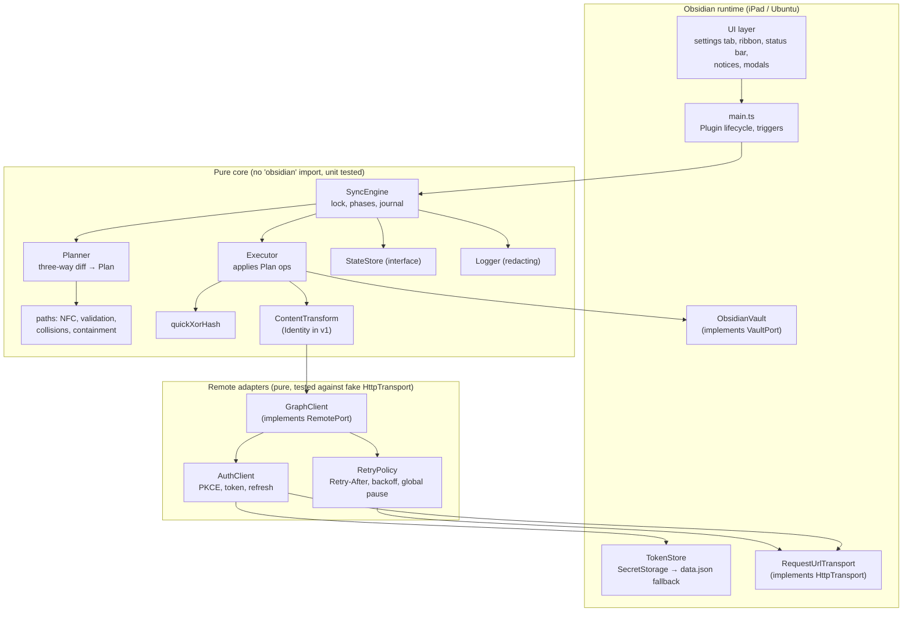
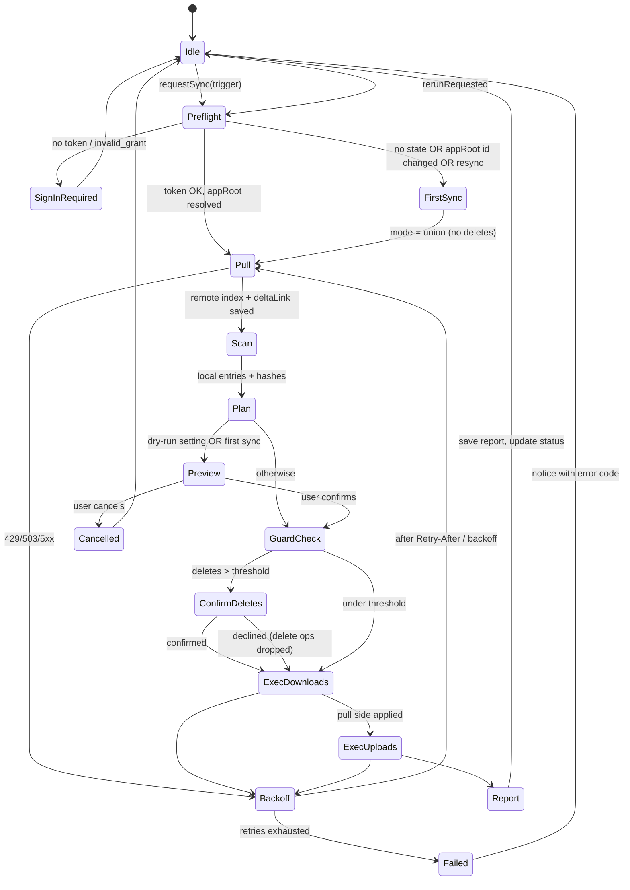

# MDVaultSync design

This document explains how the plugin is built. SPEC.md says what it must do. Fact IDs in brackets, such as `[G-UP-3]`, point to [research.md](research.md). Decision IDs, such as `D-11`, point to [SPEC.md](../SPEC.md).

## 1. Architecture



Rules:
- `src/core/**` and `src/remote/**` never import `obsidian`. ESLint enforces this with `no-restricted-imports` scoped to those folders. Tests under `test/**` run them with fakes on plain Node.
- Every byte moving between vault and Graph passes through `ContentTransform`. The engine never calls `GraphClient` content methods directly; it calls `RemoteContent`, which wraps transform plus Graph.
- Every HTTP call goes through `HttpTransport`. The only production implementation wraps Obsidian's `requestUrl` [O-API-1]. Nothing calls `fetch` or `XMLHttpRequest`, and nothing loads Node `http`.
- There are no runtime npm dependencies. Everything in `main.js` is our code (SPEC §8).

### Source layout
```
src/
  main.ts                    Plugin subclass: wiring, triggers, commands, ribbon, status bar
  ui/                        SettingsTab, PlanPreviewModal, ConfirmDeletesModal, ReportView, notices.ts
  platform/                  ObsidianVault, RequestUrlTransport, TokenStore, PluginStateStore
  remote/                    AuthClient, GraphClient, RetryPolicy, graph-types.ts, validate.ts
  core/                      engine.ts, planner.ts, executor.ts, state.ts, paths.ts,
                             quickxor.ts, transform.ts, exclude.ts, logger.ts, ports.ts, errors.ts
test/
  fakes/                     FakeVault, FakeRemote (in-memory OneDrive semantics), FakeHttp, FakeClock
  *.test.ts
```

## 2. Module interfaces (`src/core/ports.ts`)

These are the contracts. Implementations may add private helpers but must not widen these types without updating this document.

```ts
// ---------- shared ----------
export type VaultPath = string & { readonly __brand: "VaultPath" }; // NFC, '/'-separated, no leading '/', validated
export interface Clock { now(): number; sleep(ms: number): Promise<void>; }

// ---------- local vault ----------
export interface LocalEntry { path: VaultPath; size: number; mtime: number; isFolder: boolean; }
export interface VaultPort {
  list(): Promise<LocalEntry[]>;                         // excludes configDir, hidden segments, exclude patterns
  stat(path: VaultPath): Promise<LocalEntry | null>;
  read(path: VaultPath): Promise<ArrayBuffer>;
  /** Atomic replace: write to hidden temp sibling via adapter, then rename into place. */
  writeAtomic(path: VaultPath, data: ArrayBuffer): Promise<void>;
  mkdirp(path: VaultPath): Promise<void>;
  /** Vault.rename (not FileManager.renameFile): the originating device already rewrote links. */
  move(from: VaultPath, to: VaultPath): Promise<void>;
  /** FileManager.trashFile: honors the user's "Deleted files" setting [O-API-7]. */
  trash(path: VaultPath): Promise<void>;
  removeEmptyFolder(path: VaultPath): Promise<boolean>;
}

// ---------- remote ----------
export interface RemoteItem {
  id: string; parentId: string | null; name: string; isFolder: boolean;
  eTag: string; cTag: string | null; size: number; quickXorHash: string | null;
  lastModified: string; deleted: boolean;
}
export interface DeltaPage { items: RemoteItem[]; nextLink?: string; deltaLink?: string; }
export interface RemotePort {
  getAppRoot(): Promise<RemoteItem>;
  delta(link: string | null): Promise<DeltaPage>;                    // null = start full enumeration
  listChildren(folderId: string): Promise<RemoteItem[]>;             // fallback if delta unsupported [G-DL-1]
  getItem(id: string): Promise<RemoteItem | null>;
  download(id: string): Promise<ArrayBuffer>;                        // via fresh downloadUrl, no auth header [G-DLD-1]
  createFolder(parentId: string, name: string): Promise<RemoteItem>; // conflictBehavior=fail
  uploadNew(parentId: string, name: string, data: ArrayBuffer): Promise<RemoteItem>;   // fail on name clash
  uploadReplace(id: string, ifMatch: string, data: ArrayBuffer): Promise<RemoteItem>;  // 412 → PreconditionFailed
  move(id: string, ifMatch: string, newParentId: string, newName: string): Promise<RemoteItem>;
  delete(id: string, ifMatch: string): Promise<void>;                // recycle bin, never permanentDelete
  quota(): Promise<{ total: number; used: number; remaining: number } | null>; // null if scope disallows [G-QT-1]
}

// ---------- content transform (E2EE seam) ----------
export interface TransformContext { path: VaultPath; }
export interface ContentTransform {
  readonly id: string;                                    // "identity" in v1; persisted per file record
  encode(plain: ArrayBuffer, ctx: TransformContext): Promise<ArrayBuffer>;
  decode(stored: ArrayBuffer, ctx: TransformContext): Promise<ArrayBuffer>;
}

// ---------- persisted state ----------
export interface FileRecord {
  path: VaultPath; remoteId: string; eTag: string; cTag: string | null;
  size: number;            // local plaintext size at last sync
  mtime: number;           // local mtime at last sync
  localHash: string;       // quickXorHash of local plaintext
  remoteHash: string;      // quickXorHash of stored bytes (== localHash under identity transform)
  transformId: string;
}
export interface UploadSessionRecord {
  path: VaultPath; uploadUrl: string; expiresAt: string; totalSize: number;
  localHash: string; ifMatch: string | null; parentId: string; name: string;
}
export interface SyncState {
  schemaVersion: 1;
  deviceId: string;                         // random UUID, generated once per device
  appRootId: string | null;
  deltaLink: string | null;
  remoteIndex: Record<string, RemoteItem>;  // id → item (folders + files), mirror of approot subtree
  files: Record<VaultPath, FileRecord>;
  folders: Record<VaultPath, string>;       // path → remote folder id
  pendingLocal: PendingLocalOp[];           // from vault events since last successful sync
  uploadSessions: Record<VaultPath, UploadSessionRecord>;
  firstSyncCompleted: boolean;
  lastReport: SyncReport | null;
}
export type PendingLocalOp =
  | { kind: "dirty"; path: VaultPath }
  | { kind: "deleted"; path: VaultPath }
  | { kind: "renamed"; from: VaultPath; to: VaultPath };
export interface StateStore { load(): Promise<SyncState | null>; save(s: SyncState): Promise<void>; clear(): Promise<void>; }

// ---------- auth ----------
export interface TokenStore { get(): string | null; set(refreshToken: string): void; clear(): void; readonly secure: boolean; }
export interface AccessTokenProvider { getAccessToken(): Promise<string>; } // single-flight refresh

// ---------- HTTP ----------
export interface HttpRequest { url: string; method: string; headers?: Record<string, string>; body?: ArrayBuffer | string; }
export interface HttpResponse { status: number; headers: Record<string, string>; body: ArrayBuffer; }
export interface HttpTransport { send(req: HttpRequest): Promise<HttpResponse>; } // never throws on status; throws on network failure

// ---------- plan & report ----------
export type PlanOp =
  | { kind: "download"; id: string; path: VaultPath; reason: string }
  | { kind: "upload-new"; path: VaultPath }
  | { kind: "upload-replace"; path: VaultPath; id: string; ifMatch: string }
  | { kind: "remote-move"; id: string; ifMatch: string; from: VaultPath; to: VaultPath }
  | { kind: "local-move"; from: VaultPath; to: VaultPath }
  | { kind: "remote-delete"; id: string; ifMatch: string; path: VaultPath }
  | { kind: "local-trash"; path: VaultPath }
  | { kind: "conflict"; path: VaultPath; id: string; copyPath: VaultPath }
  | { kind: "adopt"; path: VaultPath; id: string }          // identical content both sides: record only
  | { kind: "forget"; path: VaultPath }                     // gone on both sides: drop record
  | { kind: "skip"; path: VaultPath; reason: SkipReason };
export type SkipReason = "too-large" | "invalid-name" | "path-too-long" | "case-collision"
  | "reserved-name" | "outside-vault" | "hidden" | "excluded" | "unicode-collision";
export interface Plan { ops: PlanOp[]; deleteCount: number; trackedCount: number; firstSync: boolean; }
export interface SyncReport {
  startedAt: number; finishedAt: number; result: "ok" | "partial" | "failed" | "cancelled";
  counts: Record<PlanOp["kind"], number>;
  conflicts: { path: VaultPath; copyPath: VaultPath }[];
  skipped: { path: VaultPath; reason: SkipReason }[];
  errors: { path: VaultPath | null; code: string }[];
}
```

The report holds file paths because the user needs to see them. Paths are never written to logs (§9). The report lives only in local plugin state.

## 3. Lifecycle and triggers
- **`onload`.** Load settings, construct modules, add commands (`sync-now`, `sync-preview`, `sign-in`, `sign-out`, `run-diagnostics`), add the ribbon icon, and add the status bar item when `Platform.isDesktopApp` [O-API-13]. Register the protocol handler `mdvaultsync-auth` [O-API-3].
- **`workspace.onLayoutReady`.** Register vault events (create, modify, delete, rename) [O-API-12]. Schedule the startup sync 5 seconds later. Start the interval timer with `registerInterval(window.setInterval(...))`, set to `settings.intervalMinutes` (default 5, minimum 1, 0 means off).
- **Vault events** append to `pendingLocal` and save. An *echo filter* drops events for paths the executor itself is writing. The filter is a `Set<VaultPath>` of in-flight writes, cleared after each write completes plus one tick.
- **Triggers** (startup, timer, command, ribbon) all call `engine.requestSync(trigger)`.
- **Mobile backgrounding.** iOS may suspend the app mid-sync. The journal (§6) makes this safe, and the next trigger resumes.

### Single-flight lock
`requestSync` works like this:
- If no sync is running, start one.
- If one is running, set `rerunRequested = true` and return the running promise. When it finishes, run exactly one more sync if `rerunRequested` is set.

Overlapping triggers therefore queue at most one extra run and never run in parallel. The lock is in memory only, which is enough because each device has one Obsidian process per vault.

## 4. Auth (D-4, D-5)

### 4.0 Flow comparison and recommendation
Each option is compared on the iPad (Obsidian for iOS) and on Ubuntu (Obsidian .deb). All options are public clients with no secret.

| | Auth code + PKCE, `obsidian://` redirect | Device code flow |
|---|---|---|
| **iPad experience** | Tap Sign in. Safari opens, sign in, then "Open in Obsidian?" and tap Open. Back in the app, signed in. | Obsidian shows a code. Switch to Safari, open the verification URL, type the code, sign in, switch back, wait for polling. There's no one-tap deep link because `verification_uri_complete` isn't supported [I-DC-1]. |
| **Ubuntu experience** | Click Sign in. The default browser opens, sign in, then the browser asks to open the `obsidian://` link, and Obsidian comes forward. Needs the scheme handler, which the .deb install registers. AppImage often doesn't, which is why the paste fallback exists. | Same code-typing flow in the browser. It works without any scheme handler. |
| **Registration** | "Mobile and desktop applications" platform with `obsidian://mdvaultsync-auth` (no query string [I-RU-2]). "Allow public client flows" stays off. | Requires "Allow public client flows = Yes" [I-DC-1]. |
| **Refresh token lifetime** | About 90 days (not SPA) [I-TL-2] | About 90 days |
| **Interception or phishing** | A stolen code can't be redeemed without the PKCE verifier [I-AC-2]. Login CSRF is blocked by single-use `state` (threat-model S1). The system browser shows the real Microsoft URL [I-BR-1]. | No redirect to intercept, but it is a known phishing pattern: an attacker starts a flow with our public client ID and persuades the user to enter the code on the real Microsoft page. Microsoft says it "recommends blocking device code flow wherever possible" [I-DC-1]. |
| **Failure modes** | No scheme handler; Safari prompt dismissed; trailing-slash callback variant [I-RU-3]; `Origin` header on token redemption [I-AC-7]. All are tested in M2 and covered by the paste fallback and lenient callback parsing. | 15-minute expiry; polling while iOS suspends the app (sign-in may stall if the user stays in Safari too long); possible future Microsoft restrictions. |
| **Code required** | PKCE, protocol handler, callback validation, token exchange. | Polling loop (`authorization_pending`, `slow_down`, `expired_token`), code display UI. |

**Recommendation: auth code + PKCE with the `obsidian://` redirect on both devices.** Owner accepted this as D-4.
- It is the flow Microsoft and RFC 8252 recommend for native apps.
- It needs one tap on each device and no extra registration switch.
- It avoids the phishing-prone device code flow.
- With the .deb install, one code path covers iPad and Ubuntu with no Node-only code, so `isDesktopOnly` can stay `false`.

**Fallback.** The `nativeclient` paste fallback covers a missing scheme handler without enabling device code. Loopback (`http://127.0.0.1`) was also considered for desktop and rejected: it needs Node `http` (desktop-only, flagged by the `no-nodejs-modules` lint rule [O-ESL-2]) and isn't needed with the .deb install.

**Sign-in, primary path:**
1. Generate a `code_verifier` of 64 random characters from the RFC 7636 alphabet, using `crypto.getRandomValues`. Compute `code_challenge = base64url(SHA-256(verifier))` with `crypto.subtle` [I-AC-2], [O-SUB-4]. Generate `state` from 32 random bytes. Keep verifier and state in memory only, with a 10-minute expiry.
2. Open `https://login.microsoftonline.com/consumers/oauth2/v2.0/authorize?client_id=…&response_type=code&redirect_uri=obsidian%3A%2F%2Fmdvaultsync-auth&response_mode=query&scope=Files.ReadWrite.AppFolder%20offline_access&code_challenge=…&code_challenge_method=S256&state=…&prompt=select_account` in the system browser with `window.open` [I-BR-1].
3. The protocol handler receives `{action:"mdvaultsync-auth", code, state}` or `{error, error_description}`. It accepts `mdvaultsync-auth/` too [I-RU-3].
   - Reject if no sign-in is pending, if it has expired, or if `state` doesn't match (constant-time compare).
   - Clear the pending state immediately so each state value is used once.
4. POST to the token endpoint with `application/x-www-form-urlencoded`: `client_id`, `grant_type=authorization_code`, `code`, `redirect_uri`, `code_verifier`, `scope`. Send no `Origin` header [I-AC-5].
5. Validate the response shape: `access_token` (string), `refresh_token` (string), `expires_in` (number, 60–86,400), `token_type == "Bearer"`. Store the refresh token in TokenStore. Keep the access token in memory only.

**Fallback (paste URL).** The settings tab has a "Sign in another way" button.
- It opens the same authorize URL with `redirect_uri=https://login.microsoftonline.com/common/oauth2/nativeclient` [I-RU-4].
- The user pastes the final address-bar URL into a text field.
- The plugin parses it with `new URL()`. It requires origin `https://login.microsoftonline.com` and path `/common/oauth2/nativeclient`, then extracts `code` and `state` and continues at step 3's checks.
- M2 verifies this on both devices. If it fails with `/consumers`, M2 records the result in research.md and replaces this fallback before closing.

**Access tokens.** `AccessTokenProvider.getAccessToken()` returns the cached token if it has more than 5 minutes left. Otherwise it refreshes, single-flight: concurrent callers await the same promise.
- After a refresh, the new refresh token *replaces* the stored one before the access token is returned [I-TL-3].
- `invalid_grant` or `interaction_required` clears the token, sets the account state to "Sign-in required", and raises a notice. Sync stops; local state is kept.

**TokenStore.**
- `set` calls `app.secretStorage.setSecret("mdvaultsync-refresh-token", rt)` [O-API-4]. If that throws, it writes `data.json.fallbackRefreshToken` and sets `secure = false`. The settings tab then shows a standing warning (D-5).
- `clear` calls `setSecret(id, "")` (there is no delete method [O-API-4]) and removes the fallback field.
- `get` treats `""` as null.

**Sign-out:**
1. `TokenStore.clear()`.
2. Drop the access token.
3. `StateStore.clear()`, which removes the delta link, remote index, file records, pending operations and upload sessions.
4. Show a notice that local files are untouched, with a link to `https://account.microsoft.com/privacy/app-access`, where the user can remove the app's access [C-MSA-1]. M2 verifies the link.

There is no revocation endpoint for public clients [I-TL-4].

## 5. Sync algorithm

Each run has phases. Each phase persists its outcome before the next one starts.



### 5.1 Preflight
- Get an access token.
- Resolve the approot with `getAppRoot()` [G-AF-1].
  - If `state.appRootId` is set and different, the folder was deleted and recreated, or replaced [G-AF-2]. Set `firstSync = true` and reset `deltaLink`, `remoteIndex`, `files` and `folders`. Local files are kept.
  - Compute the remote path prefix length from the approot's `parentReference.path` + `name`. This feeds the 400-character budget [G-NM-4].
- Resume any `uploadSessions` (§6.3).

### 5.2 Pull (remote change detection)
- Call `delta(state.deltaLink)`, starting with null on first sync. Collect pages until `deltaLink` [G-DL-2]. Validate every item (§8). Keep only the last occurrence per ID [G-DL-6].
- Apply to `remoteIndex` in memory: upsert live items and delete those with `deleted`.
- Save `remoteIndex` and the new `deltaLink` together in one `StateStore.save`. The delta token is therefore never ahead of the index. Applying changes to the vault happens later, driven by the diff between `remoteIndex` and `files`, so a crash after this save loses nothing.
- **410 or a `resync*` code** [G-DL-4]: drop `deltaLink` and `remoteIndex`, re-enumerate from null, and set `mode = union` for this run so nothing is deleted on either side.
- **Delta unsupported on approot** (M3 probe result, [G-DL-1]): `RemotePort.delta` is implemented as a breadth-first `listChildren` walk returning a synthetic page. Deletes are inferred by absence. This costs more, so the interval floor rises to 15 minutes.
- **Rebuild remote paths** from `parentId` chains rooted at the approot ID [G-DL-6], [G-DL-7]. Drop items whose chain doesn't reach the approot.

### 5.3 Scan (local change detection)
- `vault.list()` gives the local entries.
- For each file, compare `size` and `mtime` with `files[path]`. If either differs, or the path is in `pendingLocal` as dirty, compute `localHash` (quickXorHash over the bytes read). If both match, reuse the recorded hash.
- On startup the whole vault is scanned; this is the "full reconcile". On timer and command runs, only `pendingLocal` paths plus paths whose stat differs are hashed. Listing is cheap; hashing is the expensive part.
- `pendingLocal.renamed` entries are kept as rename hints for the planner.

### 5.4 Plan: three-way diff
For every key in the union of {local paths, `files` records, remote items}:
- **B** = base (the `FileRecord`).
- **L** = the local entry and its hash.
- **R** = the remote item (path and hash from `remoteIndex`).
- **Changed L** means `L.hash != B.localHash`.
- **Changed R** means `R.cTag != B.cTag`, or `R.quickXorHash != B.remoteHash` when cTag is missing [G-TAG-1].

| B | L | R | Action |
|---|---|---|---|
| – | ✓ | – | `upload-new` |
| – | – | ✓ | `download` |
| – | ✓ | ✓ | hashes equal → `adopt`; otherwise `conflict` (remote keeps name, D-9) |
| ✓ | same | same | no-op |
| ✓ | changed | same | `upload-replace` (If-Match B.eTag) |
| ✓ | same | changed | `download` |
| ✓ | changed | changed | `L.hash == R.hash` → `adopt`; otherwise `conflict` |
| ✓ | deleted | same | `remote-delete` (If-Match B.eTag); in union mode → `download` (restore) |
| ✓ | deleted | changed | `download` (remote edits win over a local delete; no data loss) |
| ✓ | same | deleted | `local-trash`; in union mode → `upload-new` (restore) |
| ✓ | changed | deleted | `upload-new` (local edits win over a remote delete) |
| ✓ | deleted | deleted | `forget` |

**Rename and move detection** runs before the table. It removes matched pairs from the table.
- **Remote renames.** The item's ID is in `files` (by `remoteId`) but its rebuilt path differs from `B.path`.
  - If L is unchanged at the old path: `local-move`, then re-check content as above.
  - If L also moved, by a different rename: the remote path wins, and the local file moves to the remote path.
- **Local renames.** A `renamed` hint from vault events, or at startup an unmatched local-new path whose hash and size equal those of an unmatched local-deleted record (unique match only).
  - If R is unchanged: `remote-move` (PATCH by ID, If-Match) [G-MV-1].
  - If R was renamed too: the remote path wins.
  - If R's content also changed: `local-move` to the remote path, then the content rules apply.
- **Folders.** Remote folder renames show up as one item [G-DL-6], and descendants are re-pathed by the rebuild in §5.2. A local folder rename produces one rename event per file plus one for the folder. The planner collapses these into one `remote-move` of the folder when every child was renamed under the same prefix.
- **Empty folders** are created on the other side when they appear. They are removed when empty after the deletes run [G-DL-5].

**Filters**, applied to every candidate path before planning (D-6, §8):
- the exclusion rules (configDir, hidden segments, user patterns);
- path validation (§7);
- the size cap, default 100 MiB, compared against `L.size` or `R.size`.

Rejected paths become `skip` ops with a reason and appear in the report. Skipped files are never deleted on the other side because of a skip.

**First sync** (no `firstSyncCompleted`, or approot changed, or resync) runs in union mode. Every row that would produce `remote-delete` or `local-trash` produces a restore instead. Every L/R pair at the same path with different content becomes a `conflict`. The plan is always shown in the preview modal first, and the user can cancel.

**Mass-delete guard.**
- `deleteCount` = number of `remote-delete` ops + number of `local-trash` ops.
- If `deleteCount > max(1, ceil(trackedCount × threshold))`, where `threshold` defaults to 25 % (setting, 1–100 %), open `ConfirmDeletesModal` listing every path.
- If the user declines, the sync continues *without* the delete ops. Their records stay as they are, so the next run asks again.

### 5.5 Execute
Order: every pull-side op first (`local-move`, `download`, `local-trash`, conflict handling), then every push-side op (`remote-move`, `upload-*`, `remote-delete`) [SPEC R-ORDER].
- Within a side, folder creation runs first (sorted shallowest first), then file ops with concurrency 4, then folder deletes (deepest first).
- After *each* op succeeds, the executor updates `files` and `folders` and saves the state. Saves are batched: at most once per second plus once at the end, so iPad writes stay low. A crash repeats at most one second of already-idempotent work.

**download:**
1. `getItem` (fresh downloadUrl [G-DLD-2]), then `download`.
2. Check `quickXorHash(bytes) == R.quickXorHash`. On a mismatch, discard and record error `hash-mismatch`.
3. `transform.decode`.
4. Containment check (§8).
5. `vault.writeAtomic`.
6. Record B = {R.eTag, R.cTag, size, mtime from the fresh stat, localHash, remoteHash}.

**upload-new:**
1. Read, hash, `transform.encode`.
2. If 10 MiB or less, `uploadNew` (`PUT …:/{name}:/content?@microsoft.graph.conflictBehavior=fail`) [G-UP-1], [G-UP-2]. Otherwise an upload session (§6.3).
3. 409 `nameAlreadyExists` means a remote item appeared since the pull. Re-pull that path with `getItem` by path, then handle it as a conflict.
4. Check that the returned hash equals the local stored-bytes hash.

**upload-replace:**
1. Read, hash, encode.
2. If the bytes are unchanged against `B.localHash` (the hash was equal after all), `adopt` instead.
3. Otherwise:
   - If the M3 probe confirmed If-Match on PUT [G-UP-3] and the file is 10 MiB or less, use `uploadReplace` via PUT.
   - Otherwise use an upload session created on the item ID with `if-match` [G-UP-5].
   - The probe result is stored as a build-time constant in `src/remote/capabilities.ts`, not decided at runtime, so behavior is reviewable.

**On 412** (any op with If-Match) [G-TAG-2]:
1. `getItem(id)`.
2. If `cTag` and hash are unchanged, it was a metadata-only change (for example the user renamed the item on OneDrive's website). Update B.eTag and the path and retry once.
3. Otherwise apply the conflict procedure.

**Conflict procedure** (D-9), which must lose zero data:
1. Compute `copyPath = <dir>/<stem> (conflict <deviceName> <YYYY-MM-DD HHmmss>)<.ext>`. The timestamp is local time, and the device name is sanitized with §7 rules. If `copyPath` exists, append ` 2`, ` 3` and so on.
2. Write the *local* bytes to `copyPath` with `writeAtomic`. Do this before anything touches the original.
3. Download remote bytes to the original path (`download` op).
4. Queue `upload-new` for `copyPath`, so the conflict copy reaches every device.
5. Add to `report.conflicts`.

After the run, a notice lists every conflict path (D-9). It stays up until clicked (`new Notice(msg, 0)`).

**remote-delete:** `DELETE /items/{id}` with If-Match → recycle bin [G-DEL-1]. Treat 404 as already gone and `forget` it. 412 means remote content changed since the pull, so `download` it back (no data loss).

**local-trash:** `vault.trash` → `FileManager.trashFile` [O-API-7].

**local-move:** `vault.move` → `Vault.rename` [O-API-8]. Links were already rewritten by the device that made the rename, and those rewrites arrive as content changes.

### 5.6 Report
- Build a `SyncReport` and save it as `state.lastReport`. Update the status bar text and ribbon tooltip: "Synced 14:02", "Syncing…", "Sync error", "Sign-in required" or "Paused (confirm deletes)".
- Raise a notice for errors and conflicts only. A successful sync with no conflicts makes no notice.
- Clear `pendingLocal` entries that the run covered. Entries added during the run stay for the next one.
- Set `firstSyncCompleted = true` only after a run finishes with `ok` or `partial` while in union mode.

## 6. Resilience

### 6.1 Retry policy (`RetryPolicy`)
- **429 or 503:** read `Retry-After` (seconds or HTTP date). Clamp it to 1–300 s. Set a *global* pause until then, so all requests wait [G-THR-1], [G-THR-2]. Retry. With no header, use backoff.
- **Other 5xx and network errors:** exponential backoff with full jitter, base 1 s, factor 2, capped at 60 s, up to 6 attempts.
- **Non-retryable:** 400, 401 (one token refresh then retry once), 403, 404, 409, 412, 413, 416 and 507. These are surfaced to the caller as typed errors (`GraphError {status, code, innerCodes}`) [G-ERR-1].
- **Whole-run budget:** if total backoff exceeds 10 minutes, abort the run with `partial` and keep progress.

### 6.2 Journal and resume
- The persisted `SyncState` *is* the journal. Completed ops are reflected in `files`, `folders` and `remoteIndex`, so a fresh plan after a restart omits them.
- `pendingLocal` survives restarts.
- An interrupted run therefore resumes by running the full algorithm again. Pull is idempotent (same `deltaLink`), and the plan contains only what is left.

### 6.3 Upload sessions (files over 10 MiB, and replace-uploads if PUT ignores If-Match)
- **Create** with `POST /items/{parentId}:/{name}:/createUploadSession` (new file) or `POST /items/{id}/createUploadSession` with `if-match` (replace). Body: `{"item":{"@microsoft.graph.conflictBehavior":"fail"|"replace"}}` [G-UP-5].
- **Persist** an `UploadSessionRecord` right after creation.
- **Fragment size:** 10 MiB = 32 × 320 KiB (`FRAGMENT = 10 * 1024 * 1024`; assert `FRAGMENT % 327_680 === 0`) [G-UP-6]. The last fragment is the remainder.
- **Send** fragments in order with `Content-Range` and **no Authorization header** [G-UP-7]. Read only that slice of the file. The Obsidian adapter API reads whole files, so on iPad memory use is the file size. This is one reason for the 100 MiB default cap.
- **Resume** (after a restart, or when a fragment fails beyond retries): `GET uploadUrl` → `nextExpectedRanges`, then continue from the first missing byte [G-UP-9].
  - Before resuming, re-hash the local file. If it changed, cancel the session (`DELETE uploadUrl`) and start over.
  - 404 or an expired session means start over.
  - 416 means that range was already received; GET the status and continue.
- **Finish:** 200 or 201 returns the item. Check its hash, then delete the session record.

## 7. Path rules (`core/paths.ts`)
Vault path to remote name:
1. **Normalize.** Unicode NFC (`String.prototype.normalize("NFC")`, matching Obsidian's `normalizePath` [O-API-16]), `/` separators, and no empty, `.` or `..` segments.
   - If two local paths become the same after NFC, skip both as `unicode-collision`. Example: Linux files `é` (precomposed) and `é` (decomposed).
2. **Exclude.**
   - Any segment beginning with `.`. This covers `.obsidian`, `.trash`, `.git` and our own temp files.
   - The first segment equal to `app.vault.configDir`, which may be renamed and not start with a dot.
   - User exclude patterns: gitignore-style globs (`*`, `**`, `?`), matched case-sensitively against the vault path. This is our own matcher of about 60 lines with tests, not a dependency.
3. **Validate each segment** [G-NM-1] … [G-NM-3]:
   - no `" * : < > ? \ |`, and no control characters U+0000–U+001F;
   - no leading or trailing space;
   - folders must not end in `.`;
   - no leading `~` (OneDrive personal also rejects `~$`);
   - no reserved names (`CON`, `PRN`, `AUX`, `NUL`, `COM0-9`, `LPT0-9` with or without an extension, compared case-insensitively; `.lock`; `desktop.ini`; any name containing `_vti_`);
   - segment length ≤ 255 UTF-16 units (assumed, M3 verifies [G-NM-6]).
   - Names are never rewritten to make them fit. Invalid files are skipped with a reason; renaming the user's files silently is worse.
4. **Path length:** `appRootPrefix.length + 1 + path.length ≤ 400` [G-NM-4].
5. **Case collisions.** Compare `path.toLocaleLowerCase("en-US")` across the union of local and remote paths. When two distinct local paths fold to the same key, which is possible on Ubuntu (ext4 is case-sensitive), the one already tracked in `files` keeps syncing. The other is skipped as `case-collision`. If neither is tracked, skip both. A remote item and a local file that differ only by case are the same file.

Remote to vault (§8): the inverse rebuild, plus containment checks.

## 8. Untrusted input handling (`remote/validate.ts`)
All Graph and token JSON passes through hand-written type guards before use. Unknown fields are ignored; missing or mistyped required fields throw `InvalidResponse`.
- **Item fields:** `id` matches `/^[A-Za-z0-9!._-]{1,256}$/`; `name` is 1–255 characters with no `/`, `\` or NUL; `size` is a safe non-negative integer; `eTag` and `cTag` are strings of at most 512 characters; `quickXorHash` matches base64 of 28 characters.
- **Response bodies:**
  - JSON responses over 32 MiB are rejected before parsing, which caps memory for a delta page.
  - Downloads longer than `R.size` + 0 are rejected.
  - Items with size over the cap are skipped without downloading.
- **Remote path to vault path:** NFC-normalize, then reject if any segment is `.`, `..` or empty, or contains `/`, `\` or NUL, or starts with `.`, or equals configDir. The path must not be absolute. The joined path must satisfy `normalizePath(joined) === joined`, and its `startsWith` check against the vault root must hold. Anything rejected is skipped as `outside-vault` or `hidden` and reported.
- **downloadUrl / uploadUrl:** `new URL()` must succeed, the protocol must be `https:`, and the host must end with an allowlisted suffix: `.microsoft.com`, `.live.com`, `.sharepoint.com`, `.1drv.com`, `.onedrive.com` or `.livefilestore.com`. M3 refines this list from observed hosts. Otherwise refuse. This stops a tampered response from sending our bytes elsewhere.
- **Token response:** string types, `token_type` Bearer, and `expires_in` within range.
- **Authorization header:** the auth decorator (`src/remote/http.ts`) adds `Authorization: Bearer …` only when the URL's origin is exactly `https://graph.microsoft.com`. Upload and download URLs never get it [G-UP-7], [G-DLD-1] (T-I4).

## 9. Logging (`core/logger.ts`)
- **API shape:** `log.event(op: OpKind, fields: { count?: number; durationMs?: number; status?: number; code?: string; attempt?: number })`. No free-form string field exists. `code` must match `/^[A-Za-z0-9_.-]{1,64}$/`; anything else is replaced with `"other"`. The types themselves make it impossible to pass a path, token or content.
- **Destination:** an in-memory ring buffer of 500 entries, viewable and copyable from the diagnostics section in settings. `console.error` is used only for errors [O-GL-1]. A "Verbose logging" toggle mirrors events to `console.debug`.
- **Test:** a unit test runs a full fake sync with sentinel strings in paths, contents and tokens, then asserts the serialized log contains none of them (M8).

## 10. UI
- **Settings tab.** Uses `Setting` and `setHeading()` [O-GL-2]; no `innerHTML` [O-GL-3]. Sections:
  - **Account:** signed-in status, Sign in, Sign in another way, Sign out, Client ID (required), and the token-storage warning when `secure=false`.
  - **Sync:** device name (default "iPad" or "Ubuntu" from `Platform`, editable), interval in minutes, maximum file size in MiB (default 100), exclude patterns (one per line), "Preview changes before every sync" (dry run), mass-delete threshold %.
  - **Last sync report:** time, result, counts, conflicts, skipped files with reasons, error codes.
  - **Diagnostics:** "Run Graph capability probe" and "Copy log".
- **Status bar** (desktop only): state and last sync time. Clicking it opens the report.
- **Ribbon icon:** click to sync now. The tooltip shows state, which is the only always-visible state on iPad.
- **PlanPreviewModal:** grouped lists (downloads, uploads, moves, deletes, conflicts, skips) with counts, and Run and Cancel buttons. Shown on first sync, on dry-run setting, and by the `sync-preview` command. The command never runs the sync unless Run is clicked.
- **ConfirmDeletesModal:** lists the paths. Buttons: "Delete N files" and "Skip deletes this time".

## 11. Configuration defaults
| Setting | Default | Range |
|---|---|---|
| intervalMinutes | 5 | 0 (off) or 1–1440; floor 15 if delta fallback is active |
| maxFileSizeMiB | 100 | 1–1024 |
| massDeleteThresholdPct | 25 | 1–100 |
| previewEveryRun | false | — (preview is always shown on first sync) |
| excludePatterns | `[]` | ≤ 200 lines |
| deviceName | from Platform | 1–40 chars, §7 rules |
| clientId | "" | GUID format |

## 12. Persisted files
| File | Contents | Written via |
|---|---|---|
| `<configDir>/plugins/mdvaultsync/data.json` | settings (+ `fallbackRefreshToken` only when SecretStorage fails) | `saveData` |
| `<configDir>/plugins/mdvaultsync/sync-state.json` | `SyncState` | adapter write to `sync-state.json.tmp`, then `adapter.rename` (or remove+rename if rename won't overwrite; see M6 [O-API-10]) |
| SecretStorage `mdvaultsync-refresh-token` | refresh token | `secretStorage.setSecret` |

`configDir` is never synced (D-6), so none of these leave the device.

## 13. Extension point: end-to-end encryption (post-v1)
To add E2EE, implement `ContentTransform` (for example AES-GCM with a key derived from a passphrase) and set `transformId`. Everything else stays the same:
- `FileRecord` already separates `localHash` (plaintext) from `remoteHash` (stored bytes).
- No-op detection compares plaintext hashes.
- Download integrity compares stored-byte hashes.
- Records with a different `transformId` are re-uploaded.

File *names* stay plaintext in v1 and in that extension. Encrypting names is out of scope (SPEC §7).
