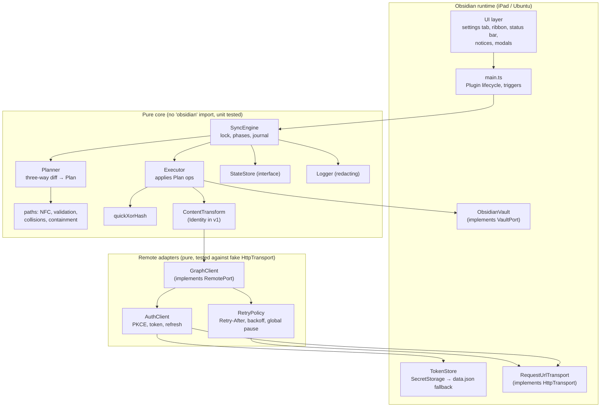
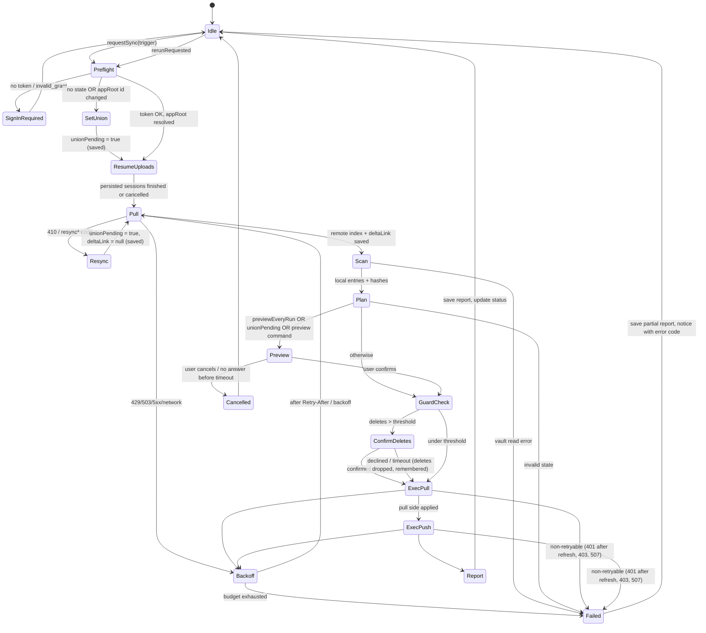

# MDVaultSync design

This document explains how the plugin is built. SPEC.md says what it must do. Fact IDs in brackets, such as `[G-UP-3]`, point to [research.md](research.md). Decision IDs, such as `D-11`, point to [SPEC.md](../SPEC.md).

## 1. Architecture



Rules:
- `src/core/**` and `src/remote/**` never import `obsidian`. ESLint enforces this with `no-restricted-imports` scoped to those folders. Tests under `test/**` run them with fakes on plain Node.
- Every byte moving between vault and Graph passes through `ContentTransform`. The executor never calls `RemotePort` content methods (`download`, `uploadNew`, `uploadReplace`, upload-session methods) directly. It calls `RemoteContent` (`src/core/remote-content.ts`, §2), which wraps transform plus `RemotePort`. ESLint's `no-restricted-syntax` flags those member calls outside `remote-content.ts`, and an M6 test with a non-identity transform proves it.
- Every HTTP call goes through `HttpTransport`. The only production implementation wraps Obsidian's `requestUrl` [O-API-1]. Nothing calls `fetch`, `XMLHttpRequest` or `WebSocket` (ESLint `no-restricted-globals`), and nothing loads Node `http`.
- There are no runtime npm dependencies. Everything in `main.js` is our code (SPEC §8).

### Source layout
```
src/
  main.ts                    Plugin subclass: wiring, triggers, commands, ribbon, status bar
  ui/        settings-tab.ts, plan-preview-modal.ts, confirm-deletes-modal.ts, report-view.ts, notices.ts
  platform/  obsidian-vault.ts, request-url-transport.ts, token-store.ts, plugin-state-store.ts, diagnostics.ts
  remote/    auth.ts, pkce.ts, http.ts (auth decorator), graph.ts, upload-session.ts, retry.ts,
             validate.ts, errors.ts (GraphError, ResyncRequired), capabilities.ts, probe.ts (diagnostics, M3)
  core/      ports.ts, engine.ts, planner.ts, executor.ts, remote-content.ts, upload-resume.ts,
             state.ts, remote-tree.ts, report.ts, paths.ts, exclude.ts, conflict-name.ts,
             quickxor.ts, transform.ts, logger.ts
test/
  fakes/                     FakeVault, FakeRemote (in-memory OneDrive semantics), FakeHttp, FakeClock
  *.test.ts
```

## 2. Module interfaces (`src/core/ports.ts`)

These are the contracts. Implementations may add private helpers but must not widen these types without updating this document.

```ts
// ---------- shared ----------
export type VaultPath = string & { readonly __brand: "VaultPath" }; // NFC, '/'-separated, no leading '/', validated
export interface Clock { now(): number; sleep(ms: number): Promise<void>; }

// ---------- local vault ----------
export interface LocalEntry { path: VaultPath; size: number; mtime: number; isFolder: boolean; }
export interface VaultPort {
  list(): Promise<LocalEntry[]>;                         // excludes configDir, hidden segments, exclude patterns
  stat(path: VaultPath): Promise<LocalEntry | null>;
  read(path: VaultPath): Promise<ArrayBuffer>;
  /** Atomic replace: write to hidden temp sibling via adapter, then rename into place. */
  writeAtomic(path: VaultPath, data: ArrayBuffer): Promise<void>;
  mkdirp(path: VaultPath): Promise<void>;
  /** Vault.rename (not FileManager.renameFile): the originating device already rewrote links. */
  move(from: VaultPath, to: VaultPath): Promise<void>;
  /** FileManager.trashFile: honors the user's "Deleted files" setting [O-API-7]. */
  trash(path: VaultPath): Promise<void>;
  removeEmptyFolder(path: VaultPath): Promise<boolean>;
}

// ---------- remote ----------
export interface RemoteItem {
  id: string; parentId: string | null; name: string; isFolder: boolean;
  eTag: string; cTag: string | null; size: number; quickXorHash: string | null;
  lastModified: string; deleted: boolean;
}
export interface DeltaPage { items: RemoteItem[]; nextLink?: string; deltaLink?: string; }
export interface AppRoot {
  item: RemoteItem;
  /** Decoded drive path of the approot WITHOUT the "/drive/root:" prefix, e.g. "/Apps/MDVaultSync". */
  pathPrefix: string;
}
export interface UploadTarget { kind: "new"; parentId: string; name: string } // or replace an existing item:
export interface UploadTargetReplace { kind: "replace"; id: string }
export interface UploadSessionInfo { uploadUrl: string; expiresAt: string; }
export interface UploadStatus { nextExpectedStart: number | null; expiresAt: string; } // null = complete or gone
export interface RemotePort {
  getAppRoot(): Promise<AppRoot>;
  delta(link: string | null): Promise<DeltaPage>;                    // null = start full enumeration
  listChildren(folderId: string): Promise<RemoteItem[]>;             // fallback if delta unsupported [G-DL-1]
  getItem(id: string): Promise<RemoteItem | null>;
  getChildByName(parentId: string, name: string): Promise<RemoteItem | null>; // after 409 nameAlreadyExists
  // upload sessions [G-UP-5]..[G-UP-9]; ifMatch applies at creation only (see §6.3 for the commit-time check)
  createUploadSession(target: UploadTarget | UploadTargetReplace, ifMatch: string | null, size: number): Promise<UploadSessionInfo>;
  putFragment(uploadUrl: string, start: number, total: number, bytes: ArrayBuffer): Promise<RemoteItem | null>; // item on final fragment
  getUploadStatus(uploadUrl: string): Promise<UploadStatus>;         // 404 → { nextExpectedStart: null }
  cancelUpload(uploadUrl: string): Promise<void>;
  download(id: string): Promise<ArrayBuffer>;                        // via fresh downloadUrl, no auth header [G-DLD-1]
  createFolder(parentId: string, name: string): Promise<RemoteItem>; // conflictBehavior=fail
  uploadNew(parentId: string, name: string, data: ArrayBuffer): Promise<RemoteItem>;   // fail on name clash
  uploadReplace(id: string, ifMatch: string, data: ArrayBuffer): Promise<RemoteItem>;  // 412 → PreconditionFailed
  move(id: string, ifMatch: string, newParentId: string, newName: string): Promise<RemoteItem>;
  delete(id: string, ifMatch: string): Promise<void>;                // recycle bin, never permanentDelete
  quota(): Promise<{ total: number; used: number; remaining: number } | null>; // null if scope disallows [G-QT-1]
}

// ---------- content transform (E2EE seam) ----------
export interface TransformContext { path: VaultPath; }
export interface ContentTransform {
  readonly id: string;                                    // "identity" in v1; persisted per file record
  encode(plain: ArrayBuffer, ctx: TransformContext): Promise<ArrayBuffer>;
  decode(stored: ArrayBuffer, ctx: TransformContext): Promise<ArrayBuffer>;
}
/** The only path content takes between executor and RemotePort (src/core/remote-content.ts). */
export interface RemoteContent {
  /** download → verify stored-bytes hash → decode. Returns plaintext and the stored-bytes hash. */
  fetch(item: RemoteItem, path: VaultPath): Promise<{ plain: ArrayBuffer; remoteHash: string }>;
  /** encode → (simple PUT | upload session) → verify returned hash. */
  store(target: UploadTarget | UploadTargetReplace, ifMatch: string | null, plain: ArrayBuffer, path: VaultPath,
        onSession?: (s: UploadSessionInfo) => Promise<void>): Promise<{ item: RemoteItem; remoteHash: string }>;
  /** Stored-bytes hash this plaintext WOULD have remotely (encode + quickXorHash). Identity: equals the plaintext hash. */
  storedHashOf(plain: ArrayBuffer, path: VaultPath): Promise<string>;
}

// ---------- persisted state ----------
export interface FileRecord {
  path: VaultPath; remoteId: string; eTag: string; cTag: string | null;
  size: number;            // local plaintext size at last sync
  mtime: number;           // local mtime at last sync
  localHash: string;       // quickXorHash of local plaintext
  remoteHash: string;      // quickXorHash of stored bytes (== localHash under identity transform)
  transformId: string;
}
export interface UploadSessionRecord {
  path: VaultPath; uploadUrl: string; expiresAt: string; totalSize: number;
  localHash: string; ifMatch: string | null;   // eTag the session was created against (replace only)
  target: UploadTarget | UploadTargetReplace;
}
export interface PendingConflict { path: VaultPath; copyPath: VaultPath; localHash: string; remoteId: string; }
export interface SyncState {
  schemaVersion: 1;
  deviceId: string;                         // random UUID, generated once per device
  appRootId: string | null;
  deltaLink: string | null;
  remoteIndex: Record<string, RemoteItem>;  // id → item (folders + files), mirror of approot subtree
  files: Record<VaultPath, FileRecord>;
  folders: Record<VaultPath, string>;       // path → remote folder id
  pendingLocal: PendingLocalOp[];           // from vault events since last successful sync
  uploadSessions: Record<VaultPath, UploadSessionRecord>;
  pendingConflicts: Record<VaultPath, PendingConflict>; // written BEFORE the conflict copy (§5.5)
  firstSyncCompleted: boolean;
  /** Persisted union mode: set when a first sync / resync / approot change starts, cleared only when a
   *  union run finishes ok|partial. Survives crashes so a resumed run can never delete (R-FIRST-1). */
  unionPending: boolean;
  /** Paths whose remote delete the user declined; not re-prompted until their local or remote state changes. */
  declinedDeletes: Record<VaultPath, { localHash: string | null; eTag: string | null }>;
  lastReport: SyncReport | null;
}
export type PendingLocalOp =
  | { kind: "dirty"; path: VaultPath }
  | { kind: "deleted"; path: VaultPath }
  | { kind: "renamed"; from: VaultPath; to: VaultPath };
export interface StateStore { load(): Promise<SyncState | null>; save(s: SyncState): Promise<void>; clear(): Promise<void>; }

// ---------- auth ----------
export interface TokenStore {
  get(): string | null;
  set(refreshToken: string): Promise<void>;   // async: the data.json fallback needs saveData
  clear(): Promise<void>;
  /** "secret-storage" = Obsidian SecretStorage (OS encryption NOT guaranteed, see §4); "plugin-data" = data.json fallback. */
  readonly backend: "secret-storage" | "plugin-data";
}
export interface AccessTokenProvider { getAccessToken(): Promise<string>; } // single-flight refresh

// ---------- HTTP ----------
export interface HttpRequest { url: string; method: string; headers?: Record<string, string>; body?: ArrayBuffer | string; }
export interface HttpResponse { status: number; headers: Record<string, string>; body: ArrayBuffer; }
export interface HttpTransport { send(req: HttpRequest): Promise<HttpResponse>; } // never throws on status; throws on network failure

// ---------- plan & report ----------
export type PlanOp =
  | { kind: "download"; id: string; path: VaultPath; reason: string }
  | { kind: "upload-new"; path: VaultPath }
  | { kind: "upload-replace"; path: VaultPath; id: string; ifMatch: string }
  | { kind: "remote-move"; id: string; ifMatch: string; from: VaultPath; to: VaultPath }
  | { kind: "local-move"; from: VaultPath; to: VaultPath }
  | { kind: "remote-delete"; id: string; ifMatch: string; path: VaultPath }
  | { kind: "local-trash"; path: VaultPath }
  | { kind: "conflict"; path: VaultPath; id: string; copyPath: VaultPath }
  | { kind: "adopt"; path: VaultPath; id: string }          // identical content both sides: record only
  | { kind: "forget"; path: VaultPath }                     // gone on both sides: drop record
  | { kind: "skip"; path: VaultPath; reason: SkipReason };
export type SkipReason = "too-large" | "invalid-name" | "path-too-long" | "case-collision"
  | "reserved-name" | "outside-vault" | "hidden" | "excluded" | "unicode-collision";
export interface Plan {
  ops: PlanOp[]; deleteCount: number; trackedCount: number;
  unionMode: boolean;
  /** No-base pairs whose content differs (stale device rejoining): each becomes a conflict; shown as its own preview group. */
  differsNoHistory: number;
}
export interface SyncReport {
  trigger: Trigger;
  startedAt: number; finishedAt: number; result: "ok" | "partial" | "failed" | "cancelled";
  counts: Record<PlanOp["kind"], number>;
  touched: { kind: PlanOp["kind"]; path: VaultPath; to?: VaultPath }[]; // every path the run changed (T-R1)
  conflicts: { path: VaultPath; copyPath: VaultPath }[];
  skipped: { path: VaultPath; reason: SkipReason }[];
  errors: { path: VaultPath | null; code: string }[];
}

// ---------- engine & logging ----------
export type Trigger = "startup" | "interval" | "command" | "ribbon" | "preview" | "rerun";
export interface SyncHooks {
  /** Show the plan; resolve true to run. Never called for unattended triggers except on first sync (see §5.4). */
  confirmPlan(plan: Plan): Promise<boolean>;
  /** Resolve true to delete, false to skip deletes this run. */
  confirmDeletes(ops: PlanOp[]): Promise<boolean>;
  onStatus(s: EngineStatus): void;
}
export type EngineStatus =
  | { state: "idle"; lastSyncAt: number | null } | { state: "syncing"; phase: string }
  | { state: "waiting-for-user" } | { state: "error"; code: string } | { state: "sign-in-required" };
export interface SyncEngine { requestSync(trigger: Trigger): Promise<SyncReport>; readonly status: EngineStatus; }
export type OpKind = "auth.refresh" | "auth.signin" | "graph.request" | "sync.run" | "sync.pull" | "sync.scan"
  | "sync.plan" | "sync.exec" | `op.${PlanOp["kind"]}` | "upload.fragment" | "upload.resume" | "retry.backoff" | "state.save";
```

The report holds file paths because the user needs to see them. Paths are never written to logs (§9). The report lives only in local plugin state.

## 3. Lifecycle and triggers
- **`onload`.** Load settings, construct modules, add commands (`sync-now`, `sync-preview`, `sign-in`, `sign-out`, `run-diagnostics`), add the ribbon icon, and add the status bar item when `Platform.isDesktopApp` [O-API-13]. Register the protocol handler `mdvaultsync-auth` [O-API-3].
- **`workspace.onLayoutReady`.** Register vault events (create, modify, delete, rename) [O-API-12]. Schedule the startup sync 5 seconds later. Start the interval timer with `registerInterval(window.setInterval(...))`, set to `settings.intervalMinutes` (default 5, minimum 1, 0 means off).
- **Vault events** append to `pendingLocal` and save. The executor registers each write it is about to make as an *expected write* `(path, hash of the bytes it writes)` in a `Map<VaultPath, string>`. Events are never dropped. Each event is recorded as `dirty`, and the scan resolves it: if the file's current hash equals the expected hash, it was our own echo and is a no-op. Otherwise it is a real user edit and syncs normally. This means a user edit made during our write can't be swallowed. Expected entries clear when the next scan consumes them.
- **Triggers** (startup, timer, command, ribbon) all call `engine.requestSync(trigger)`.
- **Mobile backgrounding.** iOS may suspend the app mid-sync. The journal (§6) makes this safe, and the next trigger resumes.

### Single-flight lock
`requestSync` works like this:
- If no sync is running, start one.
- If one is running, set `rerunRequested = true` and return the running promise. When it finishes, run exactly one more sync if `rerunRequested` is set.

Overlapping triggers therefore queue at most one extra run and never run in parallel. The lock is in memory only, which is enough because each device has one Obsidian process per vault.

## 4. Auth (D-4, D-5)

### 4.0 Flow comparison and recommendation
Each option is compared on the iPad (Obsidian for iOS) and on Ubuntu (Obsidian .deb). All options are public clients with no secret.

| | Auth code + PKCE, `obsidian://` redirect | Device code flow |
|---|---|---|
| **iPad experience** | Tap Sign in. Safari opens, sign in, then "Open in Obsidian?" and tap Open. Back in the app, signed in. | Obsidian shows a code. Switch to Safari, open the verification URL, type the code, sign in, switch back, wait for polling. There's no one-tap deep link because `verification_uri_complete` isn't supported [I-DC-1]. |
| **Ubuntu experience** | Click Sign in. The default browser opens, sign in, then the browser asks to open the `obsidian://` link, and Obsidian comes forward. This needs an `x-scheme-handler/obsidian` handler. That the .deb registers one is INFERRED from its desktop entry [O-DEB-1], and M2 checks it with `xdg-mime query default x-scheme-handler/obsidian`. M2 found the owner runs the Flatpak, which registers it [O-DEB-1]. | Same code-typing flow in the browser. It works without any scheme handler. |
| **Registration** | "Mobile and desktop applications" platform with `obsidian://mdvaultsync-auth` (no query string [I-RU-2]). "Allow public client flows" stays off. | Requires "Allow public client flows = Yes" [I-DC-1]. |
| **Refresh token lifetime** | About 90 days (not SPA) [I-TL-2] | About 90 days |
| **Interception or phishing** | A stolen code can't be redeemed without the PKCE verifier [I-AC-2]. Login CSRF is blocked by single-use `state` (threat-model S1). The system browser shows the real Microsoft URL [I-BR-1]. | No redirect to intercept, but it is a known phishing pattern: an attacker starts a flow with our public client ID and persuades the user to enter the code on the real Microsoft page. Microsoft says it "recommends blocking device code flow wherever possible" [I-DC-1]. |
| **Failure modes** | No scheme handler; Safari prompt dismissed; trailing-slash callback variant [I-RU-3]; `Origin` header on token redemption [I-AC-7]. All are tested in M2. Lenient callback parsing covers the trailing slash; there is no fallback for a missing handler (R-AUTH-3 withdrawn). | 15-minute expiry [I-DC-2]; polling while iOS suspends the app (sign-in may stall if the user stays in Safari too long); possible future Microsoft restrictions. |
| **Code required** | PKCE, protocol handler, callback validation, token exchange. | Polling loop (`authorization_pending`, `slow_down`, `expired_token`), code display UI. |

**Recommendation: auth code + PKCE with the `obsidian://` redirect on both devices.** Owner accepted this as D-4.
- It is the flow Microsoft and RFC 8252 recommend for native apps.
- It needs one tap on each device and no extra registration switch.
- It avoids the phishing-prone device code flow.
- With the .deb install, one code path covers iPad and Ubuntu with no Node-only code, so `isDesktopOnly` can stay `false`.

**No fallback (M2).** The `nativeclient` paste fallback was withdrawn by the owner (R-AUTH-3): its page showed a phishing warning, and the primary flow works on both devices (Ubuntu on 0.2.0, iPad on 0.2.1). Loopback (`http://127.0.0.1`) was also rejected: it needs Node `http` (desktop-only, flagged by the `no-nodejs-modules` lint rule [O-ESL-2]).

**Sign-in, primary path:**
1. Generate a `code_verifier` of 64 random characters from the RFC 7636 alphabet, using `crypto.getRandomValues`. Compute `code_challenge = base64url(SHA-256(verifier))` with `crypto.subtle` [I-AC-2], [O-SUB-4]. Generate `state` from 32 random bytes. Keep verifier and state in memory only. They are `prepared` until the tap and become the pending sign-in on activation; the 10-minute expiry runs from the tap. Only the latest prepare is kept, and closing the settings tab discards an untapped one.
2. Show the URL `https://login.microsoftonline.com/consumers/oauth2/v2.0/authorize?client_id=…&response_type=code&redirect_uri=obsidian%3A%2F%2Fmdvaultsync-auth&response_mode=query&scope=Files.ReadWrite.AppFolder%20offline_access&code_challenge=…&code_challenge_method=S256&state=…&prompt=select_account` as a link. **Settings (0.2.2):** the **Sign in** control *is* that link. `AuthClient.prepareSignIn()` builds the URL ahead of time and holds the verifier and state in memory (`prepared`, not yet pending). The tap's click handler calls `activateSignIn(url)` synchronously, which makes it the pending sign-in (the 10-minute expiry starts here), and the link's default navigation opens the system browser [I-BR-1]. No await sits between the tap and the navigation: iOS only opens a browser during the tap itself, and `window.open` after the digest's await was silently blocked on the iPad (M2 check 2). **Command:** a command can't hold a pre-built link, so **Sign in to OneDrive** shows the same link in a small modal (the pattern Remotely Save uses).
3. The protocol handler receives `{action:"mdvaultsync-auth", code, state}` or `{error, error_description}`. It accepts `mdvaultsync-auth/` too [I-RU-3]. `AuthClient.handleCallback(params)` checks, in this order:
   - Reject if no sign-in is pending. If it has expired, clear it and reject.
   - Reject if `state` doesn't match (constant-time compare). A wrong state does **not** clear the pending sign-in, so a forged `obsidian://` link can't cancel the user's real sign-in; the attacker can't guess the 32-byte state anyway.
   - Clear the pending state before any `await`, so each state value is used once even when two callbacks race.
   - Only then look at `error` (surfaced as a sanitized code; `error_description` is never read) or `code`.
   - `prepareSignIn` is async because `crypto.subtle.digest` is (M2); `activateSignIn` is synchronous so it can run inside the tap.
   - `prepareSignIn` (before and after its await) and `activateSignIn` refuse with `already-signed-in` while a refresh token is stored: signing in over a live grant could relink the vault to another account's App Folder without clearing sync state. A code redemption also bumps the epoch (below), so no older refresh can overwrite the new grant (M2 security review).
4. POST to the token endpoint with `application/x-www-form-urlencoded`: `client_id`, `grant_type=authorization_code`, `code`, `redirect_uri`, `code_verifier`, `scope`. Send no `Origin` header [I-AC-5].
5. Validate the response shape: `access_token` (string), `refresh_token` (string), `expires_in` (number, 60–86,400), `token_type == "Bearer"`. Store the refresh token in TokenStore. Keep the access token in memory only.

**Access tokens.** `AccessTokenProvider.getAccessToken()` returns the cached token if it has more than 5 minutes left (or more than half its lifetime, if that is shorter, so a short-lived token doesn't rotate the refresh token on every call; M2). Otherwise it refreshes, single-flight: concurrent callers await the same promise.
- After a refresh, the new refresh token *replaces* the stored one before the access token is returned [I-TL-3].
- `invalid_grant` or `interaction_required` clears the token, sets the account state to "Sign-in required", and raises a notice. Sync stops; local state is kept.
- Sign-out bumps an in-memory epoch. A refresh or code redemption that started under an older epoch discards its result (and clears the store if its write landed), so an in-flight refresh can't undo a sign-out (M2).

**Testability (M2).** `PluginTokenStore` takes a structural `SecretStorageLike` and a data accessor, and `createRequestUrlTransport` takes the `requestUrl` function. `main.ts` passes the real Obsidian objects. Neither module imports `obsidian` at runtime, so both run under `node --test`.

**TokenStore.**
- `set` calls `app.secretStorage.setSecret("mdvaultsync-refresh-token", rt)` [O-API-4] on every write, then reads it back.
  - If that throws or the read-back differs, it writes `data.json.fallbackRefreshToken` with `await saveData` and sets `backend = "plugin-data"`. The settings tab then shows a standing warning (D-5).
  - When SecretStorage works again, the next `set` (the next refresh) moves the token back and deletes the fallback field.
  - The initial `backend` is `plugin-data` when `data.json` holds a fallback token, otherwise `secret-storage`.
  - SecretStorage gives no signal when the OS can't encrypt. For example, Linux with no keyring may store the secret in plaintext without throwing [O-API-6]. So even with `backend = "secret-storage"`, settings shows a neutral note: "Stored in Obsidian secret storage. Encryption depends on your device's keyring." (M2 wording; the obsidianmd sentence-case rule rejects "OS".)
  - M2 records what actually happens on Ubuntu with and without an unlocked keyring.
- `clear` calls `setSecret(id, "")` (there is no delete method [O-API-4]) and removes the fallback field. If a token can still be read back afterwards, it throws, and sign-out shows "Sign-out is incomplete" instead of claiming success (M2 security review).
- `get` treats `""` as null.

**Sign-out:**
1. `TokenStore.clear()`.
2. Drop the access token.
3. `StateStore.clear()`, which removes the delta link, remote index, file records, pending operations, pending conflicts and upload sessions. M2 builds sign-out against a stub `StateStore`; M6 wires in the real one and tests it.
4. Show a notice that local files are untouched, with a link to `https://account.microsoft.com/privacy/app-access`, where the user can remove the app's access [C-MSA-1]. M2 verifies the link.

There is no revocation endpoint for public clients [I-TL-4].

## 5. Sync algorithm

Each run has phases. Each phase persists its outcome before the next one starts.



### 5.1 Preflight
- Get an access token.
- Resolve the approot with `getAppRoot()` [G-AF-1].
  - If there's no state, or `state.appRootId` is set and different (the folder was deleted and recreated, or replaced [G-AF-2]), set and save `unionPending = true`.
  - On an approot change, also reset `deltaLink`, `remoteIndex`, `files`, `folders` and `uploadSessions`. Local files are kept.
  - `AppRoot.pathPrefix` is `parentReference.path` with the leading `/drive/root:` removed, percent-decoded, plus `/` + `name`; for example `/Apps/MDVaultSync`. Its length, without the leading `/`, counts toward the 400-character budget [G-NM-4].
- Resume any persisted `uploadSessions` (§6.3), and finish any `pendingConflicts` (§5.5) before pulling.

### 5.2 Pull (remote change detection)
- Call `delta(state.deltaLink)`, starting with null on first sync. Collect pages until `deltaLink` [G-DL-2]. Validate every item (§8). Keep only the last occurrence per ID [G-DL-6].
- Apply to `remoteIndex` in memory: upsert live items and delete those with `deleted`.
- Save `remoteIndex` and the new `deltaLink` together in one `StateStore.save`. The delta token is therefore never ahead of the index. Applying changes to the vault happens later, driven by the diff between `remoteIndex` and `files`, so a crash after this save loses nothing.
- **410 or a `resync*` code** [G-DL-4]: set `unionPending = true`, `deltaLink = null`, and clear `remoteIndex`. Save, then re-enumerate from null. `files` (the bases) is kept, so files changed on only one side still sync normally. Union mode only stops deletes (§5.4).
- **Delta unsupported on approot** (M3 probe result, [G-DL-1]): `RemotePort.delta` is implemented as a breadth-first `listChildren` walk returning a synthetic page. Deletes are inferred by absence. This costs more, so the interval floor rises to 15 minutes.
  - **Probe result (2026-10-12, Ubuntu):** `items-id` works, so `DELTA_FORM = "items-id"`; the fallback isn't needed.
  - **M3 implementation.** `GraphClient` takes a `deltaForm` (`capabilities.ts` `DELTA_FORM`): `approot-colon` (`/me/drive/special/approot:/:/delta`), `items-id` (`/me/drive/items/{approotId}/delta`) or `children-walk`. The walk returns the approot plus every descendant as one page whose `deltaLink` is the sentinel `CHILDREN_WALK_LINK` (`"mdvaultsync:children-walk"`); passing it back walks again.
  - `GraphClient.deltaAll(link)` follows `nextLink` to the `deltaLink` (with a page cap) and returns items in server order, duplicates included. The engine keeps the last occurrence per ID. `RemotePort.delta` itself stays one page.
  - A persisted `deltaLink` is untrusted (T-T6): it must be an `https://graph.microsoft.com/v1.0/` URL, or `delta` refuses it before any request.
- **Rebuild remote paths** from `parentId` chains rooted at the approot ID [G-DL-6], [G-DL-7]. Drop items whose chain doesn't reach the approot.

### 5.3 Scan (local change detection)
- `vault.list()` gives the local entries.
- For each file, compare `size` and `mtime` with `files[path]`. If either differs, or the path is in `pendingLocal` as dirty, compute `localHash` (quickXorHash over the bytes read). If both match, reuse the recorded hash.
- On startup the whole vault is scanned; this is the "full reconcile". On timer and command runs, only `pendingLocal` paths plus paths whose stat differs are hashed. Listing is cheap; hashing is the expensive part.
- `pendingLocal.renamed` entries are kept as rename hints for the planner.

### 5.4 Plan: three-way diff
For every key in the union of {local paths, `files` records, remote items}:
- **B** = base (the `FileRecord`).
- **L** = the local entry and its hash.
- **R** = the remote item (path and hash from `remoteIndex`).
- **Changed L** means `L.hash != B.localHash` (plaintext versus plaintext).
- **Changed R** means `R.quickXorHash != B.remoteHash` (stored bytes versus stored bytes). If either hash is null, use `R.cTag != B.cTag` [G-TAG-1]. If both are unavailable, use `R.size != B.size || R.eTag != B.eTag`, then confirm by downloading and comparing.
- **Content equal across sides** (used for `adopt`) compares *stored* bytes: `RemoteContent.storedHashOf(L) == R.quickXorHash`. With the identity transform that equals the plaintext hash. With a future encrypting transform the planner instead compares `L.hash` against the plaintext hash recorded in `B` or in remote metadata. Either way the comparison lives in `RemoteContent`, not the planner, so the engine doesn't change (D-10).
- **Null remote hash** (for example a zero-byte file, or a hash missing from delta, [G-DL-8]): treat the item as having unknown content. Use cTag/size for "changed", and `getItem` before downloading. If the hash is still null, verify the download by size only and record `remoteHash = quickXorHash(bytes)`.

| B | L | R | Action |
|---|---|---|---|
| – | ✓ | – | `upload-new` |
| – | – | ✓ | `download` |
| – | ✓ | ✓ | hashes equal → `adopt`; otherwise `conflict` (remote keeps name, D-9) |
| ✓ | same | same | no-op |
| ✓ | changed | same | `upload-replace` (If-Match B.eTag) |
| ✓ | same | changed | `download` |
| ✓ | changed | changed | `L.hash == R.hash` → `adopt`; otherwise `conflict` |
| ✓ | deleted | same | `remote-delete` (If-Match B.eTag); in union mode → `download` (restore) |
| ✓ | deleted | changed | `download` (remote edits win over a local delete; no data loss) |
| ✓ | same | deleted | `local-trash`; in union mode → `upload-new` (restore) |
| ✓ | changed | deleted | `upload-new` (local edits win over a remote delete) |
| ✓ | deleted | deleted | `forget` |

**Rename and move detection** runs before the table. It removes matched pairs from the table.
- **Remote renames.** The item's ID is in `files` (by `remoteId`) but its rebuilt path differs from `B.path`.
  - If L is unchanged at the old path: `local-move`, then re-check content as above.
  - If L also moved, by a different rename: the remote path wins, and the local file moves to the remote path.
  - If L moved to the *same* target (both renamed alike, or a `remote-move` re-run after a crash): update `B.path` only, with no op.
  - Paths are compared by `caseKey` (§7.5). When the remote and local names differ only by case, they are the same file. The record takes the remote spelling, and no `local-move` is emitted. A case-only rename can only travel from local to remote (`remote-move`), never back, so the two sides can't loop.
- **Local renames.** A `renamed` hint from vault events, or at startup an unmatched local-new path whose hash and size equal those of an unmatched local-deleted record (unique match only).
  - If R is unchanged: `remote-move` (PATCH by ID, If-Match) [G-MV-1].
  - If R was renamed too: the remote path wins.
  - If R's content also changed: `local-move` to the remote path, then the content rules apply.
- **Folders.** Remote folder renames show up as one item [G-DL-6], and descendants are re-pathed by the rebuild in §5.2. A local folder rename produces one rename event per file plus one for the folder. The planner collapses these into one `remote-move` of the folder when every child was renamed under the same prefix.
- **Empty folders** are created on the other side when they appear. They are removed when empty after the deletes run [G-DL-5].
- **Remote folder deletes.** Graph's `DELETE` on a folder is recursive. A remote folder delete is planned only when `remoteIndex` shows the folder has **zero** children. That includes skipped, excluded or too-large children this device doesn't sync. It is sent with If-Match on the folder's eTag, and a 412 cancels it. Local folders are removed only if empty (`removeEmptyFolder`).

**Filters**, applied to every candidate path before planning (D-6, §8):
- the exclusion rules (configDir, hidden segments, user patterns);
- path validation (§7);
- the size cap, default 100 MiB, compared against `L.size` or `R.size`.

Rejected paths become `skip` ops with a reason and appear in the report. Skipped files are never deleted on the other side because of a skip.

**Union mode** runs while `unionPending` is true: first sync, approot change, resync, or a malformed state file. It changes only the delete rows. Every row that would produce `remote-delete` or `local-trash` produces a restore instead. Rows with a base (B ✓) otherwise follow the normal table. A resync therefore produces no extra conflicts.
- Rows with no base and differing content (`– ✓ ✓`, hashes differ) become conflicts, as in normal mode. This happens when a *stale device rejoins* after sign-out, a state reset or an approot change. Every file that differs then gets one conflict copy. That is the only way to keep both versions without history.
- The preview shows these in their own group, "Differs on both sides, no sync history (N)", so the outcome is obvious before the user confirms (`Plan.differsNoHistory`).
- The preview is always shown while `unionPending` is true, even for unattended triggers, and the user can cancel.

**Mass-delete guard.**
- `deleteCount` = number of `remote-delete` ops + number of `local-trash` ops.
- If `deleteCount > max(1, ceil(trackedCount × threshold))`, where `threshold` defaults to 25 % (setting, 1–100 %), open `ConfirmDeletesModal` listing every path.
- If the user declines, the sync continues *without* the delete ops. Those paths are recorded in `declinedDeletes` with their current local hash or remote eTag, and they aren't proposed for deletion again until either side changes. The next interval run doesn't nag; the "Sync now" command re-offers them.

**Unattended triggers and modals.**
- Startup and interval runs that need a modal (preview while `unionPending`, or the guard) open it once and wait up to **10 minutes**.
- No answer counts as Cancel for a preview, or "skip deletes" for the guard. The lock is released, and the status shows "Waiting for you: open MDVaultSync to review".
- While a modal is open for a run, other triggers only set `rerunRequested`.

### 5.5 Execute
Order: every pull-side op first (`local-move`, `download`, `local-trash`, conflict handling), then every push-side op (`remote-move`, `upload-*`, `remote-delete`) [SPEC R-ORDER].
- Within a side, folder creation runs first (sorted shallowest first), then file ops with concurrency 4, then folder deletes (deepest first).
- After each op succeeds, the executor updates `files` and `folders` in memory. State is saved at most once per second, once at the end, and immediately before any destructive op (overwrite, trash, delete, conflict). This keeps iPad writes low. A crash repeats at most one second of idempotent work: re-running a completed download or upload finds equal hashes and adopts.

**Pre-write check.** This runs before every op that overwrites, moves or trashes a *local* file: `download` onto an existing file, `local-trash`, `local-move`, and the conflict procedure.
1. Re-stat the path. If size or mtime differ from what Scan saw, re-hash.
2. If the content changed since Scan (the user typed during the sync), don't run the op. Turn it into a `conflict` for downloads, or a skip-and-resync for trash and move. The next run re-plans with the new content.
- This closes the gap between Scan and Execute for local edits. The remote side is covered by If-Match.

**download:**
1. Read the item for a fresh downloadUrl [G-DLD-2]. Use a plain `GET /items/{id}` with no `$select`: OneDrive personal omits the downloadUrl from `$select` responses (M3 probe) [G-DLD-1]. Then `RemoteContent.fetch`: download, check `quickXorHash(bytes) == R.quickXorHash` (null hash: see §5.4), and decode. On a mismatch, discard and record error `hash-mismatch`.
2. Containment check (§8), then the pre-write check.
3. Register the expected write `(path, localHash)` (§3), then `vault.writeAtomic`.
4. Record B = {R.eTag, R.cTag, size and mtime from a stat taken right after the write, localHash, remoteHash}. If that stat's hash would differ from `localHash` (the user edited in the meantime), keep B's mtime at 0 so the next scan re-hashes. The edit is then never masked.

**upload-new:**
1. Read, hash, then `RemoteContent.store` with `{kind:"new"}`. It encodes the bytes. If they are 10 MiB or less it uses `PUT …:/{name}:/content?@microsoft.graph.conflictBehavior=fail` [G-UP-1], [G-UP-2]; otherwise an upload session (§6.3).
2. 409 `nameAlreadyExists` means a remote item appeared at that name since the pull. Call `getChildByName(parentId, name)`. If its hash equals `storedHashOf(local)`, `adopt`. Otherwise run the conflict procedure (R-CONF-3).
3. Check that the returned hash equals the local stored-bytes hash.

**upload-replace:**
1. Read, hash, encode.
2. If the bytes are unchanged against `B.localHash` (the hash was equal after all), `adopt` instead.
3. Otherwise:
   - If the M3 probe confirmed If-Match on PUT [G-UP-3] and the file is 10 MiB or less, use `uploadReplace` via PUT.
   - Otherwise use an upload session created on the item ID with `if-match` [G-UP-5].
   - The probe result is stored as a build-time constant in `src/remote/capabilities.ts`, not decided at runtime, so behavior is reviewable.

**On 412** (any op with If-Match) [G-TAG-2]:
1. `getItem(id)`.
2. If `cTag` and hash are unchanged, it was a metadata-only change (for example the user renamed the item on OneDrive's website). Update B.eTag and the path and retry once.
3. Otherwise apply the conflict procedure.

**Conflict procedure** (D-9), which must lose zero data:
1. If `pendingConflicts[path]` already exists (a crash happened mid-procedure), reuse its `copyPath`. If the file there has `localHash`, skip to step 4.
2. Otherwise compute `copyPath = <dir>/<stem> (conflict <deviceName> <YYYY-MM-DD HHmmss>)<.ext>`. The timestamp is local time, and the device name is sanitized with §7 rules. If `copyPath` exists, append ` 2`, ` 3` and so on.
3. Save `pendingConflicts[path] = {path, copyPath, localHash, remoteId}` (immediate state save). Then write the *local* bytes to `copyPath` with `writeAtomic`, before anything touches the original.
4. Download remote bytes to the original path (the `download` op, including the pre-write check; that check compares against `localHash`, which the copy now preserves).
5. Queue `upload-new` for `copyPath`, so the conflict copy reaches every device. Add to `report.conflicts`, and delete `pendingConflicts[path]`.

After the run, a notice lists every conflict path (D-9). It stays up until clicked (`new Notice(msg, 0)`).

**remote-delete:** `DELETE /items/{id}` with If-Match → recycle bin [G-DEL-1]. Treat 404 as already gone and `forget` it. 412 means remote content changed since the pull, so `download` it back (no data loss).

**local-trash:** `vault.trash` → `FileManager.trashFile` [O-API-7].

**local-move:** `vault.move` → `Vault.rename` [O-API-8]. Links were already rewritten by the device that made the rename, and those rewrites arrive as content changes.

### 5.6 Report
- Build a `SyncReport` and save it as `state.lastReport`. Update the status bar text and ribbon tooltip: "Synced 14:02", "Syncing…", "Sync error", "Sign-in required" or "Paused (confirm deletes)".
- Raise a notice for errors and conflicts only. A successful sync with no conflicts makes no notice.
- Clear `pendingLocal` entries that the run covered. Entries added during the run stay for the next one.
- After a union-mode run finishes with `ok` or `partial`, set `firstSyncCompleted = true` and `unionPending = false`, and save. A run that fails or is cancelled leaves `unionPending` set, so the next run is union mode again.

## 6. Resilience

### 6.1 Retry policy (`RetryPolicy`)
- **429 or 503:** read `Retry-After` (seconds or HTTP date). Clamp it to 1–300 s. Set a *global* pause until then, so all requests wait [G-THR-1], [G-THR-2]. Retry. With no header, use backoff.
- **Other 5xx and network errors:** exponential backoff with full jitter, base 1 s, factor 2, capped at 60 s, up to 6 attempts.
- **Non-retryable:** 400, 401 (one token refresh then retry once), 403, 404, 409, 412, 413, 416 and 507. These are surfaced to the caller as typed errors (`GraphError {status, code, innerCodes}`) [G-ERR-1].
- **Whole-run budget:** if total backoff exceeds 10 minutes, abort the run with `partial` and keep progress.

**M3 implementation notes.**
- **401 refresh and retry.** This lives in `AuthorizingTransport` (`src/remote/http.ts`), below the retry policy. On a Graph 401 it calls `AuthClient.invalidateAccessToken(token)` and resends once with a fresh token; a second 401 goes back to the caller. `invalidateAccessToken` drops the cached token only if it is still the one that failed, so concurrent 401s cause one refresh. `ports.ts` is unchanged.
- **What counts as a network error.** Only `NetworkError` (thrown by the requestUrl transport, defined in `src/remote/errors.ts`) is retried. Any other exception, such as an `AuthError` from the refresh, is rethrown at once (M3 review).
- **Throttling.** Retries driven by Retry-After are bounded by the run budget, not by the 6-attempt cap. The shared pause covers every request that goes through the same `RetryPolicy`.
- **Budget reset.** `RetryPolicy.resetBudget()` starts a new run. M6's engine calls it at the start of each sync; the diagnostics command calls it per probe.
- **Transport split.** `GraphClient` uses two transports: the authorizing one for Graph API calls, and a bare `transferTransport` for download URLs and upload-session fragment, status and cancel requests. A tampered transfer URL therefore can't carry the token, even if it passed the allowlist.

### 6.2 Journal and resume
- The persisted `SyncState` *is* the journal. Completed ops are reflected in `files`, `folders` and `remoteIndex`, so a fresh plan after a restart omits them.
- `pendingLocal` survives restarts.
- An interrupted run therefore resumes by running the full algorithm again. Pull is idempotent (same `deltaLink`), and the plan contains only what is left.

### 6.3 Upload sessions (files over 10 MiB, and replace-uploads if PUT ignores If-Match)
- **Create** with `POST /items/{parentId}:/{name}:/createUploadSession` (new file) or `POST /items/{id}/createUploadSession` with `if-match` (replace). Body: `{"item":{"@microsoft.graph.conflictBehavior":"fail"|"replace"}}` [G-UP-5]. A replace session without If-Match is refused locally (R-CC-1). `fileSize` is documented for OneDrive personal, but the 0.3.0 probe on Ubuntu got 400 `invalidRequest` from a body that included it, so it isn't sent. Probe v2 records which bodies OneDrive accepts.
- **Persist** an `UploadSessionRecord` right after creation.
- **Fragment size:** 10 MiB = 32 × 320 KiB (`FRAGMENT = 10 * 1024 * 1024`; assert `FRAGMENT % 327_680 === 0`) [G-UP-6]. The last fragment is the remainder.
- **Send** fragments in order with `Content-Range` and **no Authorization header** [G-UP-7]. Read only that slice of the file. The Obsidian adapter API reads whole files, so on iPad memory use is the file size. This is one reason for the 100 MiB default cap.
- **Resume** (after a restart, or when a fragment fails beyond retries): `GET uploadUrl` → `nextExpectedRanges`, then continue from the first missing byte [G-UP-9].
  - Before resuming, re-hash the local file. If it changed, cancel the session (`DELETE uploadUrl`) and start over.
  - 404 or an expired session means start over.
  - 416 means that range was already received; GET the status and continue.
- **Commit-time precondition** (replace sessions only). Graph checks `if-match` only when the session is created [G-UP-5]; fragments and the final commit carry no precondition. So before resuming, and again before sending the **final** fragment, call `getItem(id)` and compare its eTag to `UploadSessionRecord.ifMatch`.
  - On a mismatch, another device changed the file during the upload. Cancel the session (`cancelUpload`) and run the conflict procedure.
  - What's left is a gap of one request between that check and the commit. SPEC R-CC-1 states this limit.
- **Finish:** 200 or 201 returns the item. Check its hash, then delete the session record.

## 7. Path rules (`core/paths.ts`)
Vault path to remote name:
1. **Normalize.** Unicode NFC (`String.prototype.normalize("NFC")`, matching Obsidian's `normalizePath` [O-API-16]), `/` separators, and no empty, `.` or `..` segments.
   - If two local paths become the same after NFC, skip both as `unicode-collision`. Example: Linux files `é` (precomposed) and `é` (decomposed).
2. **Exclude.**
   - Any segment beginning with `.`. This covers `.obsidian`, `.trash`, `.git` and our own temp files.
   - The first segment equal to `app.vault.configDir`, which may be renamed and not start with a dot. It is compared case-insensitively (M4, `isConfigDirName`): the iPad's file system is case-insensitive, so `Config/` would land inside a configDir named `config`. Both `caseKey` and an upper-then-lower fold are checked, so a name like `ſettings` (U+017F) can't slip past a configDir named `settings` (M4 security review).
   - User exclude patterns: gitignore-style globs (`*`, `**`, `?`), matched case-sensitively against the vault path. This is our own matcher of about 60 lines with tests, not a dependency.
   - **M4 syntax (`core/exclude.ts`).** A pattern with no `/` except a trailing one matches a name at any depth; otherwise it is anchored to the vault root (a leading `/` is dropped). A trailing `/` matches folders only. A pattern that matches a folder excludes everything under it. `**` matches zero or more folders, but a trailing `/**` needs at least one segment, so it never matches the folder itself. Blank lines and `#` comments are ignored. `!` negation is not supported (those lines are ignored), and `[` is literal. Patterns are NFC-normalized. The matcher builds no RegExp from user input (a greedy wildcard matcher plus dynamic programming over segments), so a pattern can't cause catastrophic backtracking.
3. **Validate each segment** [G-NM-1] … [G-NM-3]:
   - no `" * : < > ? \ |`, and no control characters U+0000–U+001F;
   - no leading or trailing space;
   - no U+00A0 or U+202F (M4 security review). Obsidian's `normalizePath` is believed to map them to a space; that isn't documented in `obsidian.d.ts`, so names containing them are skipped on both sides instead of being mapped. Otherwise two remote names could share one local file;
   - folders must not end in `.`;
   - no leading `~` (OneDrive personal also rejects `~$`);
   - no reserved names (`CON`, `PRN`, `AUX`, `NUL`, `COM0-9`, `LPT0-9` with or without an extension, compared case-insensitively; `.lock`; `desktop.ini`; any name containing `_vti_`);
   - segment length ≤ 255 UTF-16 units [G-NM-6]. `core/paths.ts` keeps its own `NAME_MAX`, because core can't import `src/remote`; a test asserts it equals `capabilities.ts` `NAME_MAX`.
   - Names are never rewritten to make them fit. Invalid files are skipped with a reason; renaming the user's files silently is worse.
4. **Path length:** `pathPrefix.length + 1 + path.length ≤ 400`, where `pathPrefix` is `AppRoot.pathPrefix` without the leading `/` (for example `Apps/MDVaultSync`, with `/drive/root:` already stripped, §5.1) [G-NM-4].
5. **Case collisions.** Compare `caseKey(path) = path.toLocaleLowerCase("en-US")` across the union of local and remote paths. When two distinct local paths fold to the same key, which is possible on Ubuntu (ext4 is case-sensitive), the one already tracked in `files` keeps syncing. The other is skipped as `case-collision`. If neither is tracked, skip both. A remote item and a local file that differ only by case are the same file.
   - **Folders (M4).** `findCollisions` also compares folders, including folders implied by file paths. When a folder loses, every path under it is skipped with the same reason, because OneDrive would merge `Notes/` and `notes/` into one folder. The same applies to folders equal after NFC.

Remote to vault (§8): the inverse rebuild, plus containment checks.

## 8. Untrusted input handling (`remote/validate.ts`)
All Graph and token JSON passes through hand-written type guards before use. Unknown fields are ignored; missing or mistyped required fields throw `InvalidResponse`.
- **Item fields:**
  - `id` matches `/^[A-Za-z0-9!._-]{1,256}$/` and is not made only of dots (M3 review: `..` in a URL path would climb out of `/items/`);
  - `name` is 1–400 characters with no `/`, `\` or NUL, and is not `.` or `..` (M3). The cap is the 400-character full-path limit [G-NM-4], not 255: OneDrive accepted a 256-character name in the 0.3.0 probe, and rejecting it here made every delta page fail. Whether a long name syncs is the planner's decision (M4 `validateSegment`, skip `invalid-name`). Names we *send* stay at most 255 (`NAME_MAX`) until the probe proves more;
  - `size` is a safe non-negative integer;
  - `eTag` and `cTag` are printable-ASCII strings of at most 512 characters, because they go back out as If-Match (M3 review);
  - `quickXorHash` matches base64 of 28 characters.
  - Deleted items may omit `size`, `cTag`, `eTag` and `name` [G-DL-5].
  - The approot's decoded `pathPrefix` must have only valid name segments with no control characters, and be at most 400 characters long.
  - Names and If-Match values we *send* get the same checks: the name rules above (at most 255 characters), and If-Match as printable ASCII of at most 512 characters.
- **Response bodies:**
  - JSON responses over 32 MiB are rejected before parsing, which caps memory for a delta page.
  - Downloads whose byte length differs from `R.size` are rejected.
  - Items with size over the cap are skipped without downloading.
- **Remote path to vault path:** NFC-normalize, then reject if any segment is `.`, `..` or empty, or contains `/`, `\` or NUL, or starts with `.`, or equals configDir. The path must not be absolute. The joined path must satisfy `normalizePath(joined) === joined`, and its `startsWith` check against the vault root must hold. Anything rejected is skipped as `outside-vault` or `hidden` and reported.
  - **M4 implementation (`core/paths.ts`).** `remoteToVaultPath(segments, configDir, pathPrefixLen, isFolder)` NFC-normalizes each name. It rejects as `outside-vault` an empty, `.` or `..` segment, a segment containing `/`, `\` or a control character U+0000–U+001F (NUL included), and a first segment with a drive prefix (`C:`). It rejects as `hidden` any segment starting with `.`, and a first segment equal to configDir under `caseKey`. Then it runs `validatePath` (every name through `validateSegment`, then the 400-character limit), so a remote name of 256–400 characters is skipped as `invalid-name`. Finally the joined path must be unchanged by `toVaultPath` (the pure stand-in for `normalizePath`, which core can't import). Vault paths are relative by construction, so there is no root to `startsWith`-check; the segment rules carry that guarantee. `containmentProblem(path, configDir)` applies the same containment rules to a joined path; M6 calls it again right before every local write (T-T1).
- **downloadUrl / uploadUrl:** `new URL()` must succeed, the protocol must be `https:`, and there must be no userinfo or port. The host must end with an allowlisted suffix: `.microsoftpersonalcontent.com`, `.1drv.com`, `.onedrive.com` or `.livefilestore.com`. `graph.microsoft.com` itself is refused. Otherwise refuse with `UntrustedUrl`, which carries no URL. This stops a tampered response from sending our bytes elsewhere.
  - **M3 history.** The list started as `.microsoft.com`, `.live.com`, `.sharepoint.com`, `.1drv.com`, `.onedrive.com`, `.livefilestore.com`.
    - The probe found OneDrive personal's upload and download host, `my.microsoftpersonalcontent.com` (Microsoft-registered, [G-UP-11]). It was added in 0.3.3.
    - At M3 close (0.3.6) the list was narrowed. `.sharepoint.com` is gone because any company can own a tenant subdomain. `.microsoft.com` and `.live.com` are gone as huge zones with no observed use.
    - The three OneDrive content suffixes stay as failover for a server-side host change.
  - **Where the check runs.** At the point of use: `uploadUrl` when the session is parsed and on every fragment, status and cancel request; `downloadUrl` in `download()` right before the GET. Parsing an item doesn't check its `downloadUrl`, so a new CDN host can't break every item read.
- **Token response:** string types, `token_type` Bearer, and `expires_in` within range.
- **Authorization header:** the auth decorator (`src/remote/http.ts`) adds `Authorization: Bearer …` only when the URL's origin is exactly `https://graph.microsoft.com`. Upload and download URLs never get it [G-UP-7], [G-DLD-1] (T-I4).

## 9. Logging (`core/logger.ts`)
- **API shape:** `log.event(op: OpKind, fields: { count?: number; durationMs?: number; status?: number; code?: string; attempt?: number })`. No free-form string field exists. `code` must match `/^[A-Za-z0-9_.-]{1,64}$/`; anything else is replaced with `"other"`. The types themselves make it impossible to pass a path, token or content.
- **Implementation (M3):** `RingLogger` in `src/core/logger.ts`. At runtime it copies only the known numeric fields (dropping non-finite values) and the filtered `code`, and drops events whose `op` isn't OpKind-shaped. Extra keys smuggled past the types are ignored. `GraphClient` logs `graph.request {status, durationMs}`, or `{code: <error name>}` when a request throws; `RetryPolicy` logs `retry.backoff {attempt, status | code: "network", durationMs}`.
- **Destination:** an in-memory ring buffer of 500 entries, viewable and copyable from the diagnostics section in settings. `console.error` is used only for errors [O-GL-1]. A "Verbose logging" toggle mirrors events to `console.debug`.
- **Test:** a unit test runs a full fake sync with sentinel strings in paths, contents and tokens, then asserts the serialized log contains none of them (M8).

## 10. UI
- **Settings tab.** Uses `Setting` and `setHeading()` [O-GL-2]; no `innerHTML` [O-GL-3]. Sections:
  - **Account:** signed-in status, Sign in, Sign out, Client ID (required), and the token-storage line (a warning when `backend = "plugin-data"`, otherwise the neutral SecretStorage note from §4).
  - **Sync:** device name (default "iPad" or "Ubuntu" from `Platform`, editable), interval in minutes, maximum file size in MiB (default 100), exclude patterns (one per line), "Preview changes before every sync" (dry run), mass-delete threshold %.
  - **Last sync report:** time, result, counts, conflicts, skipped files with reasons, error codes.
  - **Diagnostics:** "Run Graph capability probe" and "Copy log". Since M3, the probe runs from the `run-diagnostics` command ("Run OneDrive capability probe"). The probe logic is `src/remote/probe.ts`, not `src/platform/diagnostics.ts`, because the R-ENG-4 lint rule allows RemotePort content calls only in `src/remote/**` and `remote-content.ts`, and so it can be unit tested. `platform/diagnostics.ts` only wires the command and `ui/diagnostics-modal.ts` shows the JSON. The settings button arrives with the rest of R-UI-1 in M7.
- **Status bar** (desktop only): state and last sync time. Clicking it opens the report.
- **Ribbon icon:** click to sync now. The tooltip shows state, which is the only always-visible state on iPad.
- **PlanPreviewModal:** grouped lists (downloads, uploads, moves, deletes, conflicts, skips) with counts, and Run and Cancel buttons. Shown on first sync, on dry-run setting, and by the `sync-preview` command. The command never runs the sync unless Run is clicked.
- **ConfirmDeletesModal:** lists the paths. Buttons: "Delete N files" and "Skip deletes this time".

## 11. Configuration defaults
| Setting | Default | Range |
|---|---|---|
| intervalMinutes | 5 | 0 (off) or 1–1440; floor 15 if delta fallback is active |
| maxFileSizeMiB | 100 | 1–1024 |
| massDeleteThresholdPct | 25 | 1–100 |
| previewEveryRun | false | — (preview is always shown on first sync) |
| excludePatterns | `[]` | ≤ 200 lines |
| deviceName | from Platform | 1–40 chars, §7 rules |
| clientId | "" | GUID format |

## 12. Persisted files
| File | Contents | Written via |
|---|---|---|
| `<configDir>/plugins/mdvaultsync/data.json` | settings, plus `fallbackRefreshToken` only when SecretStorage throws | `saveData` |
| `<configDir>/plugins/mdvaultsync/sync-state.json` | `SyncState` | adapter write to `sync-state.json.tmp`, then `adapter.rename` (or remove+rename if rename won't overwrite; see M6 [O-API-10]) |
| SecretStorage `mdvaultsync-refresh-token` | refresh token | `secretStorage.setSecret` |

`configDir` is never synced (D-6), so none of these leave the device.

## 13. Extension point: end-to-end encryption (post-v1)
To add E2EE, implement `ContentTransform` (for example AES-GCM with a key derived from a passphrase) and set `transformId`. Everything else stays the same:
- `FileRecord` already separates `localHash` (plaintext) from `remoteHash` (stored bytes).
- No-op detection compares plaintext hashes.
- Download integrity compares stored-byte hashes.
- Records with a different `transformId` are re-uploaded.

File *names* stay plaintext in v1 and in that extension. Encrypting names is out of scope (SPEC §7).
