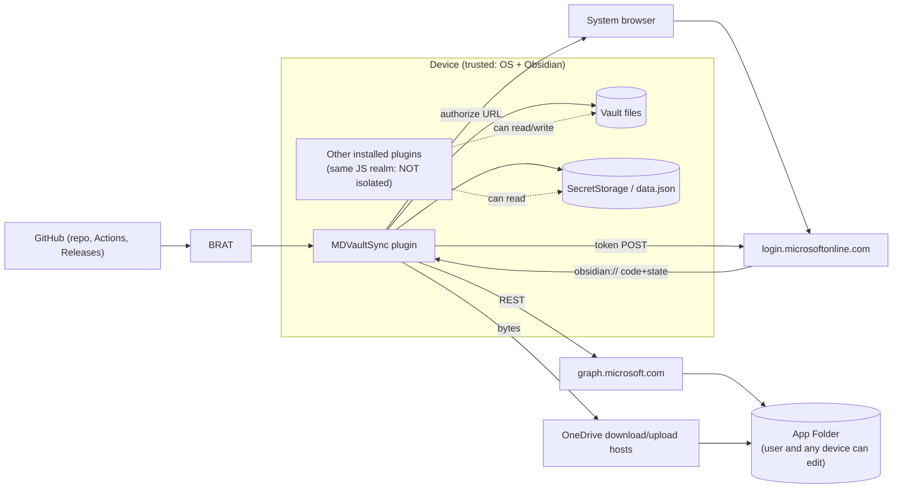

# MDVaultSync threat model

This model follows STRIDE (Spoofing, Tampering, Repudiation, Information disclosure, Denial of service, Elevation of privilege). It covers token theft, malicious remote content, path traversal, the supply chain, and data loss. Each mitigation has an ID (`T-…`) and the milestone in [plan.md](plan.md) that delivers it. The security-reviewer subagent from M1 checks each milestone's diff against the rows for that milestone. The **Status** column (M8 review, 2026-10-12) says whether each row is implemented and where it is tested, or why not: an accepted risk, or work owed in M9.

## 1. Assets
| Asset | Why it matters |
|---|---|
| A1 Refresh token | About 90 days of read and write access to the App Folder, renewed on each use [I-TL-2], [I-TL-3] |
| A2 Access token | 60–90 minutes of the same access [I-TL-1] |
| A3 Vault contents (local) | The owner's notes and attachments |
| A4 Vault copy in the App Folder | The same data, plus the propagation channel to every other device |
| A5 Sync state (`sync-state.json`) | Wrong state causes wrong deletes and overwrites |
| A6 Release artifacts (`main.js`) | Code that runs with full vault access on every device |
| A7 Source repo and CI | The origin of A6 |

## 2. Trust boundaries and data flow

Boundaries:
- **TB1** Plugin ↔ network, via `requestUrl`.
- **TB2** Plugin ↔ the other plugins in the same JavaScript realm.
- **TB3** OS ↔ protocol-handler callers, since any app or web page can open `obsidian://` URLs.
- **TB4** GitHub build ↔ the installed artifact.
- **TB5** App Folder content ↔ the local vault. Remote content is untrusted: it can come from the OneDrive web UI, other devices, or a compromised device.

Out of the attacker model: a fully compromised OS or Obsidian binary (the attacker already has everything), and Microsoft's own services.

## 3. Threats and mitigations

### Spoofing
| ID | Threat | Mitigation | Milestone | Status |
|---|---|---|---|---|
| S1 | A malicious web page or app opens `obsidian://mdvaultsync-auth?code=X&state=Y` to inject an attacker's authorization code. This is login CSRF, and it would connect the vault to the attacker's OneDrive. | **T-S1.** Accept a callback only while a sign-in is pending (10-minute expiry). Compare `state` (32 random bytes) in constant time, use it once, and use PKCE: the attacker's code can't be redeemed without our `code_verifier` [I-AC-2]. A prepared but untapped sign-in accepts no callback; the 10 minutes start at the tap. | M2 | Implemented (M2; `test/auth.test.ts`: no pending, expiry, state mismatch, single use, untapped link). |
| S2 | Another iOS app registers the `obsidian://` scheme and intercepts the code. | **T-S2.** PKCE S256 makes an intercepted code useless [I-AC-2]. The code lifetime is about 1 minute [I-AC-3]. | M2 | Implemented (M2; PKCE S256, `test/pkce.test.ts`, `test/auth.test.ts`). |
| S3 | A phishing page imitates the Microsoft sign-in. | **T-S3.** Sign-in happens only in the system browser, never an embedded webview (the settings **Sign in** link, or the link in the command's modal; both open the default browser, verified on Ubuntu and the iPad in M2), so the user sees the real URL and their password manager works [I-BR-1]. Device code flow, a known phishing vector, is not enabled [I-DC-1]. | M2 | Implemented (M2; system browser only, checked on both devices; no device code flow). |
| S4 | ~~The paste fallback is fed a URL from an attacker's site.~~ | **T-S4.** n/a since 2026-10-12: the paste fallback was removed (R-AUTH-3 withdrawn), so the only callback channel is `obsidian://`, covered by T-S1. | M2 | n/a (paste fallback removed, R-AUTH-3 withdrawn). |
| S5 | DNS or TLS interception impersonates Graph or login. | **T-S5.** HTTPS only, through `requestUrl` (platform TLS validation). Transfer URLs must use `https:` and an allowlisted host suffix (design §8). | M3 | Implemented (M3; `test/validate.test.ts`, `test/graph.test.ts`). M8 review of the redirect carry-in: `requestUrl` follows a redirect from an allowlisted transfer host without re-checking the target [O-API-2]. Accepted: the transfer transport is bare, so no token can go along (T-I4); downloaded bytes are length- and hash-checked (T-T4); and the redirect comes from Microsoft's own host, which is outside the attacker model (§2). |

### Tampering
| ID | Threat | Mitigation | Milestone | Status |
|---|---|---|---|---|
| T1 | **Path traversal.** Remote names or parent chains resolve outside the vault (`..`, absolute paths, backslashes, NUL) or into `.obsidian`, which would plant a plugin and run code. | **T-T1.** Validate in `validate.ts` and `paths.ts`: no `.`, `..`, empty segments, `/` or `\` inside names, NUL or control characters. Reject any hidden segment and any configDir segment. The `normalizePath` round-trip must be unchanged and the path must not be absolute. The containment check runs *again* immediately before `writeAtomic` (defense in depth). Fuzz-style unit tests cover hostile names. | M4 (rules), M6 (pre-write check) | Implemented (M4 rules, fuzz-style tests in `test/paths.test.ts`; M6 pre-write re-check in the executor and `ObsidianVault`, `test/executor.test.ts`, `test/obsidian-vault.test.ts`). |
| T2 | **Malicious remote JSON.** Wrong types, huge pages or unexpected shapes crash the engine or corrupt state. | **T-T2.** Hand-written type guards on every response. Required fields are type-checked and unknown fields ignored. JSON bodies over 32 MiB are rejected. IDs, eTags and hashes are checked for format and length. Downloads larger than the declared size are rejected. | M3 | Implemented (M3; `test/validate.test.ts`, `test/errors.test.ts`). |
| T3 | **Malicious remote content** (a note with a script, a crafted PDF). | **T-T3.** The plugin never renders, parses or runs file contents; it moves bytes. Rendering is Obsidian's job and carries the same risk as any file the user adds. The README states this. Hidden and config paths are never written (T-T1), so remote content can't become plugin code. | M6, M9 (README) | Implemented (M6: bytes are moved, never parsed or run). The README statement is owed in M9. |
| T4 | Remote bytes corrupted or swapped in transit or at rest. | **T-T4.** Check QuickXorHash of the downloaded bytes against the item's hash before the atomic rename. Check upload results against the local hash [G-HASH-1]. QuickXorHash is not cryptographic; it detects corruption, not a deliberate attacker who controls Graph, and Graph is trusted here. | M6 | Implemented (M6; `test/remote-content.test.ts`, `test/quickxor.test.ts`). |
| T5 | Tampered upload or download URL sends our bytes to a third party. | **T-T5.** Host allowlist for `uploadUrl` and `downloadUrl` (design §8), checked at the point of use; `graph.microsoft.com` is refused. Transfers go through a transport with no auth decorator, so they never carry `Authorization` [G-UP-7], [G-DLD-1]. M3 refined the list from the probe. `.microsoftpersonalcontent.com` was added after observation and a WHOIS check [G-UP-11]. At M3 close the list was narrowed to that suffix plus `.1drv.com`, `.onedrive.com` and `.livefilestore.com`: `.sharepoint.com` was dropped because any tenant can own a subdomain, and `.microsoft.com` and `.live.com` were dropped as too broad. | M3 | Implemented (M3; allowlist and bare transfer transport, `test/graph.test.ts` checks `authLeaks` is empty). Redirects: see S5. |
| T6 | Another plugin edits `sync-state.json` or `data.json`. | **T-T6.** Accepted risk: plugins share one realm (TB2). State is schema-validated on load, and a malformed file triggers a first-sync (union, no deletes) instead of acting on it. | M5 | Accepted risk (TB2), with the mitigation implemented (M5: schema validation, malformed state → union; `test/state.test.ts`). |
| T7 | **Supply chain:** a compromised npm dev dependency injects code into `main.js`. | **T-T7.** Zero runtime dependencies. A short, justified dev-dependency list (SPEC §8) with committed lockfile and `npm ci`. Dependabot, `npm audit --audit-level=high` in CI, CodeQL, and GitHub Actions pinned by SHA. Release built only in Actions from a tag, with `actions/attest` provenance [C-GH-3]. The README documents `gh attestation verify`. | M1 (CI, Dependabot, CodeQL, audit), M9 (release + attestation) | Implemented for M1 (lockfile, `npm ci`, Dependabot, CodeQL, audit, SHA pins; `test/workflows.test.ts`). Open for M9: the 1.0.0 release with its attestation, and the README `gh attestation verify` text. |
| T8 | **Supply chain:** maintainer account takeover pushes a malicious release. | **T-T8.** 2FA on the GitHub account (owner action, checklist in M9). Tag protection rule. Releases are drafted by CI and published by hand. The attestation ties each release to its commit. Secret scanning and push protection are enabled [C-GH-2]. 2FA, secret scanning and push protection are M1 owner actions, verified with `gh api`; the tag ruleset is M9. | M1, M9 | Implemented for M1 (2FA, secret scanning, push protection, verified with `gh api`). Open for M9: the tag ruleset (owner action); drafts are already published by hand. |

### Repudiation
| ID | Threat | Mitigation | Milestone | Status |
|---|---|---|---|---|
| R1 | The user can't tell what the plugin did, or which device deleted or overwrote a file. | **T-R1.** A per-run `SyncReport` lists every path touched (`touched`), with conflicts and skips. Conflict copies carry the device name. Remote deletes go to the OneDrive recycle bin, and local deletes go to the trash. The log ring buffer records operation counts and codes. | M5 (report), M7 (UI) | Implemented (M5 report, M7 report view and notices; conflict copies carry the device name). |

### Information disclosure
| ID | Threat | Mitigation | Milestone | Status |
|---|---|---|---|---|
| I1 | **Token theft by another plugin.** SecretStorage is a shared store that every plugin can list and read [O-API-5]. `data.json` is readable too. | **T-I1.** Residual risk, accepted and documented. A secret store can't isolate code in the same realm. The scope is limited to the App Folder (D-3), so a stolen token reaches only the vault copy, not the rest of OneDrive. The README tells users to install only plugins they trust and how to revoke access [C-MSA-1]. Access tokens are never persisted. | M2, M9 | Accepted risk (documented); scope limited to the App Folder (T-E2), access tokens never persisted. The README text is owed in M9. |
| I2 | **Token theft from disk.** (Also: a refresh token left in SecretStorage by an uninstalled copy; Obsidian has no uninstall hook [O-API-19]. Cleared at the next load when the plugin folder holds neither `data.json` nor `sync-state.json`, R-AUTH-9, M6 follow-up. The grant stays valid at Microsoft until the user removes it at the account page [I-TL-4].) SecretStorage storage on iOS is undocumented. On Linux without a keyring it may be unencrypted [O-API-6]. The `data.json` fallback is plaintext. | **T-I2.** Use SecretStorage first. Show a standing settings warning when the fallback is in use. SecretStorage itself can't report whether the OS encrypted the value, so settings always says encryption depends on the OS keyring. configDir is never synced, so `data.json` doesn't reach OneDrive (D-6). M2 records the observed behavior on both devices in research.md. Residual risk: an attacker with file access to the device or its backups can take the token. Mitigation for users: device encryption (iPad passcode, LUKS on Ubuntu) and revoking access from the Microsoft account page. | M2 | Implemented (M2 SecretStorage first, fallback warning; M6 follow-up R-AUTH-9 clears a leftover token). Residual risk stated in §4; README text owed in M9. |
| I3 | Tokens, file names or contents leak into logs, console or bug reports. | **T-I3.** The typed logger API has no free-text field, and codes are regex-filtered. `console.error` is used only for errors and without payloads. A sentinel test asserts no path, content or token appears in serialized logs. Error objects from `requestUrl` are reduced to status and code before logging. | M3 (logger), M8 (sentinel test) | Implemented (M3 typed logger; M8 sentinel test `test/logging.sentinel.test.ts` over the engine and remote stack: the ring buffer and every `console.*` call made during it. The `console.error` calls in `main.ts` and `src/platform/` aren't run by the test; the M8 review read each one: they log only an error's `name` or a fixed code). |
| I4 | Authorization header sent to non-Graph hosts. | **T-I4.** The auth decorator (`src/remote/http.ts`) adds `Authorization` only when the URL origin is `https://graph.microsoft.com`; that rule is unit tested. Upload and download URLs never get it [G-UP-7]. | M2 (decorator + test), M3 (Graph URLs) | Implemented (M2 decorator, `test/http.test.ts`; M3 Graph URLs, `test/graph.test.ts` `authLeaks`; M8: the sentinel test checks the tokens never reach a log). |
| I5 | OneDrive content readable by Microsoft or by someone with the account password. | **T-I5.** Accepted for v1 (plain files). The `ContentTransform` seam allows E2EE later (D-10). The README says files are stored unencrypted in OneDrive. | M4 (seam), M9 (README) | Accepted for v1 (D-10 seam in place, M4). The README text is owed in M9. |
| I6 | Sensitive notes leak to a device the user didn't intend. | **T-I6.** Exclude patterns, and syncing only within the user's own account. | M4 (matcher), M7 (setting) | Implemented (M4 matcher, M7 setting; unreadable patterns pause sync, fail closed). |

### Denial of service and data loss
Data loss is the top risk for a sync tool.

| ID | Threat | Mitigation | Milestone | Status |
|---|---|---|---|---|
| D1 | **Mass delete.** A bug, emptied remote folder, cleared state or new device makes the engine think everything was deleted. Also: a recursive remote folder delete removing children this device skips. | **T-D1.** First-sync union mode with no deletes (R-FIRST-1). `unionPending` is persisted so a crash can't end union mode early. An App Folder ID change or resync forces union mode (D-18). Remote folders are deleted only when the index shows zero children (R-DEL-3). The mass-delete guard with confirmation (R-GUARD-1). A malformed state file triggers union mode (T-T6). Deletes are recoverable from the recycle bin and trash (D-8). | M5, M6, M7 | Implemented (M5 union mode and delete rules, property-tested; M6 persistence; M7 guard modal). Owner matrix rows 1, 7 and 9 re-check it on devices (M8). |
| D2 | **Lost edits in a conflict**, or a local edit made *during* a sync. | **T-D2.** `pendingConflicts` is saved, then the local copy is written before the original is touched; a crash mid-procedure reuses the same copy. The conflict copy is uploaded. A pre-write re-stat and re-hash turns any overwrite or trash of a file edited since Scan into a conflict or a deferral (R-CONF-4). The echo filter never drops events; it matches on (path, hash). Replace upload sessions re-check the eTag before the final fragment (design §6.3). Edits beat deletes in both directions. The planner table is fully unit tested, including a property-style test that checks no input combination drops bytes that only one side had. | M5, M6 | Implemented (M5 planner table and property test; M6 conflict procedure and pre-write re-check). Owner matrix rows 11 and 12 (M8). M8 matrix row 2: the conflict procedure compares bytes before writing a copy, so identical files listed without a hash are adopted, not copied (`test/engine.test.ts`). |
| D3 | **Partial write or crash corrupts a note.** | **T-D3.** Temp-then-rename writes. The hash is checked before rename. State is saved only after each operation succeeds. M6 verifies `adapter.rename` overwrite semantics on both devices and documents the fallback [O-API-10]. | M6 | Implemented (M6; temp-then-rename, rename semantics verified on both devices). |
| D4 | **Interrupted sync** (iOS suspension, network loss). | **T-D4.** Idempotent phases: the delta link and index are saved together, and completed operations are recorded per op. Upload sessions are persisted and resumed [G-UP-9]. | M6 | Implemented (M6; crash injection in `test/engine.test.ts`). M8: requests time out (`src/remote/timeout.ts`), so a hung request ends the run `partial` instead of holding the lock. A late write lands safely through If-Match or conflictBehavior=fail; an upload session's final fragment has neither, so it never times out and keeps the lock (M8 review; `test/graph.test.ts`, `test/timeout-transport.test.ts`). Owner matrix rows 2 and 3. |
| D5 | **Throttling or blocking by Microsoft** from aggressive polling. | **T-D5.** Delta with a token (1 resource unit) [G-DL-9]. Retry-After honored with a global pause. Exponential backoff with jitter. A 10-minute backoff budget per run. Minimum interval of 1 minute, or 15 minutes on the listing fallback. The single-flight lock. | M3, M7 | Implemented (M3 retry policy and budget, `test/retry.test.ts`; M7 interval floor and single-flight lock). M8: a timeout isn't retried within the run; while 2 timed-out requests still hang, unattended runs pause with a notice (`test/triggers.test.ts`); quota reads send once and never wait, pause or spend a run's budget (`test/retry.test.ts`). |
| D6 | **Memory exhaustion on iPad** from large files, since requestUrl buffers whole bodies [O-API-2]. | **T-D6.** 100 MiB default cap (D-12). 10 MiB upload fragments. JSON size cap. M3 checks a large-file round trip on the iPad. | M3, M6 | Implemented (M3, M6; large-file round trip on both devices). Owner matrix row 4 (size cap). |
| D7 | **Quota exhaustion** (5 GB free; recycle bin counts too) [C-OD-1], [G-DEL-2]. | **T-D7.** Handle 507 and `quotaLimitReached` as a clear notice. Read quota for the settings display when the scope allows it [G-QT-1]. | M8 | Implemented (M8): 507 and `quotaLimitReached` → `quota`, not retried, the run ends `failed` with a notice pointing at **OneDrive storage** (`test/graph.test.ts`, `test/engine.test.ts`, `test/notices.test.ts`); the settings line reads `/me/drive` quota, readable under AppFolder (M3 probe) [G-QT-1] (`test/quota.test.ts`). Not part of the owner matrix: filling a 5 GB drive isn't practical; tested with fakes. |
| D8 | **Sync loop:** the plugin's own writes trigger vault events that look like new edits. | **T-D8.** Echoes are recorded like any event and resolved by the scan: the re-hashed file equals its sync record, so nothing is planned (design §3). Vault events don't trigger syncs, so an echo can't start a loop; repeated hints are deduplicated and capped (M7). | M7 | Implemented (M7; echo tests in `test/engine.test.ts`). |

### Elevation of privilege
| ID | Threat | Mitigation | Milestone | Status |
|---|---|---|---|---|
| E1 | Remote content turns into executable plugin code by being written under configDir. | **T-E1.** Same as T-T1: configDir and hidden paths are never written from remote. | M4, M6 | Implemented (M4, M6; same tests as T1). |
| E2 | Plugin asks for more Graph scope than it needs. | **T-E2.** Only `Files.ReadWrite.AppFolder offline_access` (R-AUTH-4). A unit test asserts the exact scope string. | M2 | Implemented (M2; `test/auth.test.ts` asserts the exact scope). |
| E3 | The plugin loads remote code, which the developer policies forbid [O-POL-3]. | **T-E3.** No `eval`, no `new Function`, no dynamic `import()` of URLs. Enforced by ESLint (`no-eval`, `no-implied-eval`, `no-new-func`) and the security-reviewer agent. | M1 | Implemented (M1; ESLint rules, `test/lint-rules.test.ts`). |
| E4 | CI workflows abused (e.g. `pull_request_target`, overly broad token permissions). | **T-E4.** Workflows set `permissions: contents: read` by default. The release job alone gets `contents: write`, `id-token: write` and `attestations: write` [O-REL-1]; the build job that runs npm code has `contents: read` only. No `pull_request_target`. Actions pinned by SHA. `test/workflows.test.ts` checks these. | M1, M2 (release.yml pulled forward), M9 | Implemented (M1, M2; `test/workflows.test.ts`). M9 reviews release.yml again for 1.0.0. |

## 4. Residual risks, stated plainly (copied into the README in M9)
1. Any other Obsidian plugin you install can read MDVaultSync's refresh token and your vault. This is true of every Obsidian plugin. The token reaches only the MDVaultSync folder in your OneDrive.
2. On Linux without a working keyring, and possibly on iOS, the token may be stored unencrypted on disk. Use full-disk encryption or a device passcode.
3. Files are stored unencrypted in your OneDrive in v1.
4. QuickXorHash detects corruption, not deliberate tampering by someone who controls your OneDrive account.
5. To cut off a lost device, remove the app at https://account.microsoft.com/privacy/app-access or change your Microsoft account password [I-TL-4], [C-MSA-1].
